# 08 — Pascal (`GP104GL` / Tesla P4) KVM vGPU (`535.309.01`) Static Analysis & Clean-Room Rust Reimplementation

## 1. Overview & Motivation

NVIDIA dropped vGPU support for the Pascal architecture (`GP10x`, including the Tesla P4 `10de:1bb3`) in the R535 EOL cycle (June 2026). This document records the complete static binary analysis, disassembly, firmware isolation, and clean-room Rust reimplementation (`nova-vgpu`) of `NVIDIA-GRID-Linux-KVM-535.309.01-539.72` (`Host_Drivers/NVIDIA-Linux-x86_64-535.309.01-vgpu-kvm.run`), performed on the Ubuntu 26.04 LTS (`Linux 7.0.0-43-generic`) Tesla P4 VM (`192.168.1.15`).

## 2. REA `6.9.0` + Ghidra `12.2` Analysis Evidence

Every binary in the `535.309.01-vgpu-kvm` host package was analyzed with `rea@6.9.0` backed by `Ghidra 12.2` (`OpenJDK 25.0.5.0.3`, analysis profile `661a5dc61cb156c53a255bb2c8acfa7f458bed434347ff1ef84643624b29aa48`). Full JSON records are preserved in [evidence/vgpu-535/](../evidence/vgpu-535/).

| Artifact | Size (B) | SHA-256 (prefix) | Entropy | Decompiled Functions (`written/requested`, `failed`) | REA Evidence ID |
| :--- | ---: | :--- | ---: | :--- | :--- |
| `libnvidia-vgxcfg.so.535.309.01` | 59,464 | `76cbfb2c357ad0e8` | 5.0061 | `147 / 187` (`40` ext, `0` failed) | `ev_e035f226cc4576c19bc1f3e1fcc5f967a215ff8d8a9c4a69f5c6effeb5adde62` |
| `nvidia-vgpud` | 137,664 | `2ed289a9fe5dea93` | 5.7654 | `320 / 402` (`82` ext, `0` failed) | `ev_01674869c7e7d8c0387334e5d545e3c12e8ec5c94a73ce115b3b8d3db0d60ad7` |
| `nvidia-vgpu-mgr` | 175,392 | `22381a200a403bfe` | 5.8431 | `488 / 609` (`121` ext, `0` failed) | `ev_b432d57974bf6003b80ac3082006edd0c2e1d5c064630b83c6dc37ee9d07f777` |
| `libnvidia-vgpu.so.535.309.01` | 3,798,584 | `a9e2ca850cbbce29` | 5.1508 | `6,734 / 6,884` (`150` ext, `0` failed) | `ev_596f90f9a892c1302188d2ad4c0daae7369e2f0e9322770e61cf991585f34ce2` |
| `nv-kernel.o_binary` (`535.309.01`) | 64,030,680 | `8c753d0898c478c5` | 7.2596 | `259` `BindataStorage` archives (`32,498,832` B raw) | `ev_e0c85e1f3ce88902a50c92671cbff99efc90dc62a11c1a6e727d64ac3e0b22b9` |
| `p4_vgpu_535_slice.o` (HAL + `nv_vgpu_*`) | 121,760 | `5e921d88ef63cc5e` | — | `51 / 83` (`32` ext, `0` failed) | `ev_d4280d183d3a9563a04c9c1a606367a2b5bebdb7e590722fc3907dffd104f10f` |

## 3. Host vGPU Architecture (MIT Kernel Shims vs. Userspace Daemons)

```mermaid
flowchart LR
    XML["vgpuConfig.xml (12 Tesla P4 Profiles)"] --> VGPUD["nvidia-vgpud (Rust: config + rm_vgpu)"]
    VGPUD -->|"RmControl 0xa0810101 / 0xa0810109"| RM["nvidia.ko (nv-kernel.o_binary + Signed Falcons)"]
    RM -->|"nv_vgpu_get_type_ids / os_call_vgpu_vfio"| VFIO["nvidia-vgpu-vfio.ko (MIT C mdev driver)"]
    VFIO -->|"/dev/nvidia-vgpu-ctl ('r' ioctl 0xc01072xx)"| MGR["nvidia-vgpu-mgr (Rust: vmiop + VgpuManager)"]
    VFIO -->|"/dev/nvidia-vgpuN ('q' ioctl 0xc01071xx)"| MGR
    MGR -->|"vmiop_display_vmiop_plugin VER_5_0 (0xa8B)"| PLUGIN["libnvidia-vgpu.so (Rust: pci_cfg + bar0_emul + vrpc + vmmu + chidmgr + frl)"]
```

### 3.1 `nvidia-vgpud` & `libnvidia-vgxcfg.so`
Decompiling `FUN_00402ca0` in `nvidia-vgpud` and `vgxConfigOpen` (`0x103570`) in `libnvidia-vgxcfg.so` revealed:
1. Opens `vgpuConfig.xml` (`NV_VGPU_CFG_FILE` or `/usr/share/nvidia/vgpu/vgpuConfig.xml`).
2. Opens `/dev/nvidiactl` + `/dev/nvidia%d`, checks virtualization mode via RM control `0x800289`.
3. Allocates RM class `0xa081` (`NVA081_VGPU_CONFIG`), pushes `fractionalMultiVgpu` (`0xa0810119`), pushes each supported `<vgpuType>` plus its 128-byte `<digest>` inside a `0x1368`-byte (`4968`-byte) `NVA081_CTRL_VGPU_CONFIG_SET_INFO_PARAMS` payload via `0xa0810101`, and triggers mdev registration via `0xa0810109`.

### 3.2 `nvidia-vgpu-vfio.ko` & `nvidia-vgpu-mgr`
The kernel module `kernel/nvidia-vgpu-vfio/` (MIT-licensed C) exposes two char-device ioctl surfaces (`nv-vgpu-ioctl.h`):
- `/dev/nvidia-vgpu-ctl` (`_IOWR('r', 0x01..0x07, 16)` = `0xc0107201..0xc0107207`): registers `CREATE_DEVICE (1)`, `DELETE_DEVICE (2)`, `OPEN_DEVICE (3)`, `GET_INSTANCES (4)` eventfds handled in `FUN_00111f30` of `nvidia-vgpu-mgr`.
- `/dev/nvidia-vgpu%d` (`_IOWR('q', 0x01..0x17, 16)` = `0xc0107101..0xc0107117`): per-VM event loop (`FUN_00115e00`) servicing `VM_REG_ACCESS (1)`, `VM_SHUTDOWN (2)`, `VM_REBOOT (3)`, `ATTACH_DEVICE (4)`, `CONSOLE_INFO (5)`, `MIGRATION_STATE (6)`, `BAR_INFO (10)`, guest page pinning (`TRANSLATE_GFN_TO_PFN 0x07`, `UNPIN_PAGES 0x08`), and interrupt injection (`INJECT_INTERRUPT 0x09`).
- Region `mmap()` encodes region type in `vm_pgoff[43:40]`: `1` = Console, `2` = Migration, `3` = Staging.

### 3.3 `libnvidia-vgpu.so` & Pascal `GP104` Emulation (`idx = 0x1f`)
Disassembling `vmiop_display_vmiop_plugin` (`0x590d80`, `168` bytes, header `0x0005_0000_0000_00a8`, signature `"VMIOP_PLUGIN_SIGNATURE"`), `_nv003575vgpu` (`0x22fe60`), `_nv004799vgpu` (`0x25f4f0`, table `0x4e6a80`), and `_nv004044vgpu` (`0x2427c0`) mapped all 29 virtualized GPU subsystems for `GP104` (`arch=0x13, impl=0x4 -> idx=0x1f`):
- **Virtual PCI Config Space (`_nv004114vgpu` / `_nv004120vgpu`)**: Exposes `10de:1bb3` with profile-specific `subsystem_id` (e.g., `0x1204` for `P4-1Q`, `0x1205` for `P4-2Q`, `0x1207` for `P4-8Q`), 16 MiB BAR0, `bar1Length` (256 MiB) BAR1, 32 MiB BAR3, and MSI/PM capabilities.
- **Virtualized `NV_VGPU` BAR0 Doorbell (`0x8f000..0x90000`, `_nv007333vgpu` / `_nv007414vgpu`)**:
  - `0x8f000..0x8f008`: `SEND_RING` GPA & PUT pointer
  - `0x8f010..0x8f01c`: `RECV_RING` GPA & GET pointer
  - `0x8f020`: `VGPU_CONFIG` (`0x201` base + ECC bit `1<<18`)
  - `0x8f024`: `VGPU_FB_SIZE` (`(usable_fb_bytes - 1) >> 12`)
  - `0x8f028` / `0x8f02c`: `VGPU_INTR_STATUS` / `VGPU_INTR_ENABLE`
  - `0x8f030..0x8f03c`: `EVENT_RING` GPA & GET pointer
  - `0x8f050`: `RPC_DOORBELL` (wakes RPC worker to drain `SEND_RING`)
  - `0x8f054`: `MSG_RING` out-of-band control
- **Guest <-> Host `"VRPC"` Protocol (`_nv011617vgpu` `0x1c4870.c`, `FUN_001c73d0`)**: 32-byte header (`version = 0x0300_0000`, `signature = 0x4350_5256`, `total_length`, `func_id`, `result`, `spare`, `seq`, `flags`). Guest must initialize via `func_id = 1` (`SetGuestSystemInfo`) before calling RM/channel/static-info RPCs.
- **Engine Isolation (`NV_PMC`, `NV_UFLUSH`, `NV_PFB`, `NV_PGRAPH`)**:
  - `NV_PMC` (`0x0000..0x1000`, `_nv008153vgpu`): returns `BOOT_0 = 0x1340_00a1`, `BOOT_42`, `ENABLE | 0x10100`, virtualized interrupts.
  - `NV_UFLUSH` (`0x70000..0x70010`, `_nv007800vgpu`): returns `0` on read, ACKs writes.
  - `NV_PFB` FBPA CSTATUS (`0x10f20c..0x11320c`, `_nv007794vgpu`): returns virtualized guest VRAM size in MiB.
  - `NV_PGRAPH` (`0x400000..0x600000`, `_nv008136vgpu`): drops guest writes unless NvWatch is enabled; only passes through read-only GPC/TPC/SM floor-sweeping registers (`0x500c30..0x52a608`).

## 4. Falcon Firmware Boundary in `535.309.01` vs `580.178.04`

Executing the compiled `535.309.01` Physical HAL setters (`_nv003382rm` ACR, `_nv003443rm` PMU, `_nv003426rm` SEC2, `_nv003378rm` NVENC, `_nv003419rm` NVDEC, `_nv003313rm` FECS, `_nv003317rm` GPCCS) for `HAL_IMPL_GP104 = 0x1f` and extracting the blobs into [`firmware-blobs/gp104-vgpu-535/`](../firmware-blobs/gp104-vgpu-535/README.md) proved:

1. **No separate vGPU Falcon firmware exists on Pascal**: `acr_bl` (`02df5be8...`), `pmu_bl` (`f21f1cfb...`), `sec2_rtos` (`7b30debe...`, `221,440` B), `sec2_hs` (`0208fc41...`, `65,792` B), `nvenc_hs_scrub` (`c581260c...`), `fecs_ls_sig` (`bdb7d23c...`), `fecs_bl_code` (`a350776a...`), `gpccs_ls_sig` (`452d3267...`), `gpccs_bl_code` (`7f78dd89...`), and `gr_netlist` (`0cfca063...`, `90,552` B, `Jun 28 2019`, `32` sections) are **SHA-256 bit-for-bit identical** to `580.178.04`.
2. **535-branch ucode builds**: `pmu_rtos` (`294,400` B, `c6fbbb4b...`, `Tue Mar 4 2025` build stamp), `nvenc0/1` (`230,912` B), and `nvdec` (`110,080` B) are 535-branch signed builds carrying valid `LsfSigInfo` footers (`fid=0` PMU, `fid=4` NVENC, `fid=5` NVDEC).
3. All Falcon binaries remain isolated and untouched for silicon `PrivSec` Light-Secure authentication (`sctl = 0x7021`).

## 5. Tesla P4 (`10de:1bb3`) vGPU Profiles & Clean-Room Rust Crate (`nova-vgpu`)

All 12 profiles in `vgpuConfig.xml` pack cleanly into `4,968`-byte `NVA081` descriptors and satisfy exact `8,192 MiB` partitioning (`profileSize = framebuffer + fbReservation`):

| Profile | ID | Class | Subsys ID | Profile Size | Usable FB | Reservation | Max | CUDA | ECC | FRL |
| :--- | ---: | :--- | :--- | ---: | ---: | ---: | ---: | :---: | :---: | :---: |
| `GRID P4-1B` | 71 | NVS | `0x1203` | 1024 MiB | 896 MiB | 128 MiB | 8 | 0 | 0 | 45 FPS |
| `GRID P4-1B4` | 243 | NVS | `0x133c` | 1024 MiB | 896 MiB | 128 MiB | 8 | 0 | 0 | 45 FPS |
| `GRID P4-2B` | 157 | NVS | `0x1288` | 2048 MiB | 1856 MiB | 192 MiB | 4 | 0 | 0 | 45 FPS |
| `GRID P4-2B4` | 214 | NVS | `0x12f1` | 2048 MiB | 1856 MiB | 192 MiB | 4 | 0 | 0 | 45 FPS |
| `GRID P4-1Q` | 63 | Quadro | `0x1204` | 1024 MiB | 896 MiB | 128 MiB | 8 | 1 | 1 | 60 FPS |
| `GRID P4-2Q` | 64 | Quadro | `0x1205` | 2048 MiB | 1856 MiB | 192 MiB | 4 | 1 | 1 | 60 FPS |
| `GRID P4-4Q` | 65 | Quadro | `0x1206` | 4096 MiB | 3776 MiB | 320 MiB | 2 | 1 | 1 | 60 FPS |
| `GRID P4-8Q` | 66 | Quadro | `0x1207` | 8192 MiB | 7616 MiB | 576 MiB | 1 | 1 | 1 | 60 FPS |
| `GRID P4-1A` | 67 | NVS | `0x1208` | 1024 MiB | 896 MiB | 128 MiB | 8 | 0 | 0 | 60 FPS |
| `GRID P4-2A` | 68 | NVS | `0x1209` | 2048 MiB | 1856 MiB | 192 MiB | 4 | 0 | 0 | 60 FPS |
| `GRID P4-4A` | 69 | NVS | `0x120a` | 4096 MiB | 3776 MiB | 320 MiB | 2 | 0 | 0 | 60 FPS |
| `GRID P4-8A` | 70 | NVS | `0x120b` | 8192 MiB | 7616 MiB | 576 MiB | 1 | 0 | 0 | 60 FPS |

The clean-room Rust reimplementation in [`nova-vgpu/`](../nova-vgpu/Cargo.toml) (`config.rs`, `vfio_ioctl.rs`, `rm_vgpu.rs`, `pci_cfg.rs`, `vrpc.rs`, `bar0_emul.rs`, `vmmu.rs`, `vmiop.rs`, and `nova_vgpu_tool.rs`) compiles cleanly with `rustc 1.93.1` on `192.168.1.15`, passes all `cargo test` unit/integration tests, parses the live `535.309.01` `vgpuConfig.xml`, validates the extracted `535.309.01` Falcon descriptors/LS signatures via `falcon_blobs.rs`, and executes an end-to-end `GRID P4-2Q` mdev + BAR0 + `"VRPC"` + `CHIDMGR` + `VMMU` simulation without disturbing the VM's passed-through Tesla P4 (`0000:01:00.0`).
