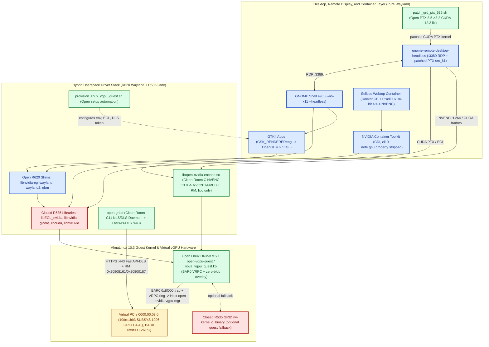
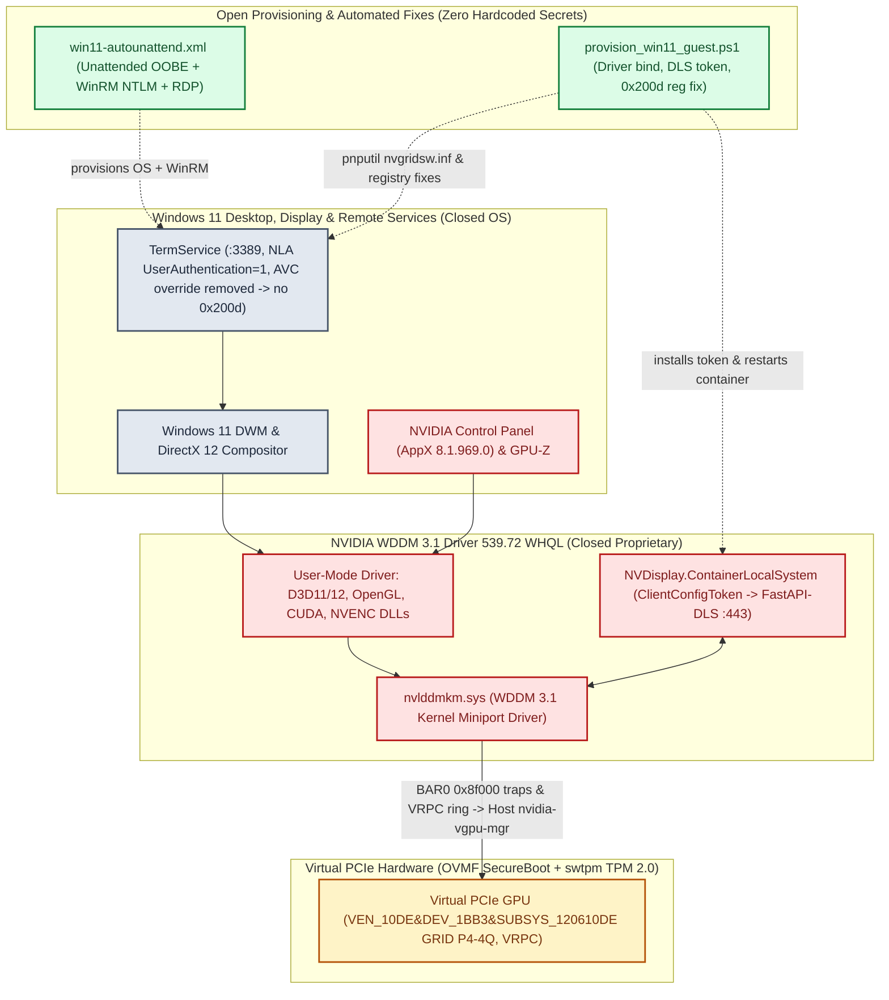
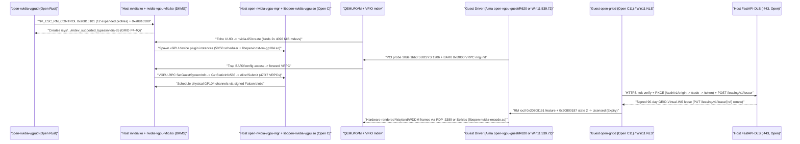

# Open-Source vs. Closed-Source vGPU Software Architecture (Host & Guests)

This document visualizes how clean-room open-source components, upstream open-source software, and retained closed-source binaries work together across the **Hypervisor Host** (`192.168.1.24`), the **AlmaLinux 10.3 Wayland/Selkies Guest** (`192.168.1.68`), and the **Windows 11 24H2 WDDM Guest** (`192.168.1.65`) in the 50/50 Tesla P4 (`GRID P4-4Q` / `nvidia-65`) virtualization stack.

### Color Legend (Mermaid Diagrams)

| Class | Meaning | Examples |
| :--- | :--- | :--- |
| Green | **Clean-Room Open Source (Ours)** | `open-nvidia-vgpud` (Rust), `libopen-vgxcfg.so` (C), `open-nvidia-xid-logd` (C), `open-nvidia-vgpu-mgr` (C), `open-nvidia-smi` + `libopen-nvidia-ml.so` (C), `libopen-nvidia-vgpu.so` (C), `open-vgpu-guest` + `nova_vgpu_guest.ko` (C), `libopen-nvidia-encode.so` (C), `libopen-host-rm-gp104.so` (C), `open-gridd` (`nvidia-gridd`, C11), provisioning & PTX patch scripts |
| Blue | **Upstream Open Source** | Linux KVM/VFIO/mdev, QEMU/OVMF/`swtpm`, FastAPI-DLS, GNOME 49.5, FreeRDP, Docker/Selkies, NVIDIA MIT/GPL kernel shims & R620 Wayland shims |
| Red / Orange | **Closed Source (NVIDIA Proprietary)** | `nv-kernel.o_binary`, `libnvidia-vgpu.so`, signed Falcon blobs (`PrivSec=1`), Guest `nvlddmkm.sys` & `libcuda` |
| Slate | **Closed Source OS / Client** | Windows 11 24H2 Kernel, DWM, `TermService` (`:3389`) |

---

## 1. Host Software Architecture (`192.168.1.24` — Ubuntu 26.04 KVM / Proxmox VE 8–9)

```mermaid
flowchart TB
    classDef ours fill:#dcfce7,stroke:#15803d,stroke-width:2px,color:#14532d
    classDef oss fill:#dbeafe,stroke:#1d4ed8,stroke-width:2px,color:#1e3a8a
    classDef closed fill:#fee2e2,stroke:#b91c1c,stroke-width:2px,color:#7f1d1d
    classDef hw fill:#fef3c7,stroke:#b45309,stroke-width:2px,color:#78350f

    subgraph H_USER["Host Userspace Control Plane, Mediation, and Licensing"]
        XML["vgpuConfig.xml (/usr/share/nvidia/vgpu/)"]:::closed
        VGPUD["open-nvidia-vgpud (Rust, GPL-2.0): RM profile registrar"]:::ours
        VGXCFG["libopen-vgxcfg.so (C, 9 vgxConfig* exports, 0 diff vs NVIDIA)"]:::ours
        XID["open-nvidia-xid-logd (C, dlopen NVML + 76-char Base64 dump)"]:::ours
        MGR["open-nvidia-vgpu-mgr (C, 60 vmiop* exports & worker runtime)"]:::ours
        LIB_VGPU["libopen-nvidia-vgpu.so (C, 47/47 VRPCs + hybrid interposer)"]:::ours
        HOST_RM["libopen-host-rm-gp104.so (C, WPR1 LSF + 22 profiles + 50/50 CHID)"]:::ours
        VMIOP_SO["libnvidia-vgpu.so.535.309.01 (Closed vmiop backend, hybrid fallback)"]:::closed
        SMI["open-nvidia-smi + libopen-nvidia-ml.so (C, clean-room RM telemetry & vGPU CLI)"]:::ours
        DLS["FastAPI-DLS v2 (:443, Docker or systemd venv)"]:::oss
        FAN["h61-fan-control (Python PWM >= 60C thermal loop)"]:::ours
        SYSFS["sysfs mdev_supported_types (nvidia-65 = GRID P4-4Q)"]:::oss
    end

    subgraph H_HYP["Hypervisor & Virtual Device Layer (QEMU/KVM or Proxmox VE)"]
        QEMU_ALMA["QEMU + OVMF: vm-alma (192.168.1.68, 4 vCPU, 5120M)"]:::oss
        QEMU_WIN["QEMU + OVMF SecBoot + swtpm: vm-win11 (192.168.1.65, 4 vCPU, 6144M)"]:::oss
        BR0["Host Bridge br0 / vmbr0 (VLAN/LAN 192.168.1.0/24)"]:::oss
    end

    subgraph H_KRN["Host Kernel Space (Linux 7.0.0-43 / Proxmox VE DKMS 535.309.01)"]
        NV_SHIM["nvidia.ko OS Shim (Linux GPL/MIT DKMS wrapper)"]:::oss
        NV_CORE["nv-kernel.o_binary (Closed RM Core & ioctl dispatch)"]:::closed
        VGPU_VFIO["nvidia-vgpu-vfio.ko (Open MIT KVM/VFIO mdev mediation driver)"]:::oss
        KVM_VFIO["Linux KVM, vfio-pci, mdev, iommu=pt"]:::oss
    end

    subgraph H_HW["Physical Silicon (UEFI Coreboot + Intel VT-d)"]
        GPU["Tesla P4 GP104GL (10de:1bb3): 8 GiB GDDR5 (4 GiB + 4 GiB), PrivSec=1"]:::hw
        FALCON["Signed Falcon Firmware: ACR, PMU, SEC2, FECS, GPCCS, NVENC, NVDEC"]:::closed
    end

    XML --> VGPUD
    VGPUD -- "/dev/nvidiactl RM ioctls 0xa0810101 + 0xa0810109" --> NV_SHIM
    NV_SHIM <--> NV_CORE
    NV_CORE <--> VGPU_VFIO
    VGPU_VFIO --> SYSFS

    MGR <-- "/dev/nvidia-vgpu* & vmiop RPC" --> VGPU_VFIO
    MGR <-- "dlvsym VER_5_0 / VER_2_0 & vmiop_* ABI" --> LIB_VGPU
    LIB_VGPU <-- "RM HAL (WPR1 / 50-50 CHID)" --> HOST_RM
    LIB_VGPU -. "hybrid parity passthrough (optional)" .-> VMIOP_SO
    MGR -. "reads vgxConfig* if queried" .-> VGXCFG
    XID -- "dlopen libnvidia-ml.so.1" --> SMI
    SMI -- "RM NVML ioctl" --> NV_SHIM
    FAN -- "sysfs / nvidia-smi temp" --> SMI

    QEMU_ALMA -- "vfio-pci mdev 1111...0003" --> VGPU_VFIO
    QEMU_WIN -- "vfio-pci mdev 1111...0005" --> VGPU_VFIO
    QEMU_ALMA <--> BR0
    QEMU_WIN <--> BR0
    DLS <-- "HTTPS /-/client-token & leases" --- BR0

    VGPU_VFIO --> KVM_VFIO
    NV_CORE -- "MMIO & DMA via Intel VT-d" --> GPU
    KVM_VFIO -- "PCIe BAR passthrough / traps" --> GPU
    GPU --- FALCON
```

---

## 2. Guest Software Architectures (Separate Per-Guest Stacks)

### 2A. AlmaLinux 10.3 Guest (`192.168.1.68` — Pure Wayland + Headless RDP + Selkies)



### 2B. Windows 11 24H2 Guest (`192.168.1.65` — WDDM 3.1 + RDP)



---

## 3. Cross-Boundary Boot-to-Frame Interaction Sequence



---

## 4. Component Boundary Summary

| Component | Layer | Origin | License / Binary State | Responsibility |
| :--- | :--- | :--- | :--- | :--- |
| `open-nvidia-vgpud` | Host Userspace | **Ours** | Open (Rust, GPL-2.0) | Parses `vgpuConfig.xml`, expands license strings, registers 12 Tesla P4 types in RM |
| `libopen-vgxcfg.so` | Host Userspace | **Ours** | Open (C, 0-diff parity) | Exports all 9 `vgxConfig*` XML query functions |
| `open-nvidia-xid-logd` | Host Userspace | **Ours** | Open (C) | Monitors NVML XID events cleanly via `dlopen`, logs 76-char Base64 dumps |
| `open-nvidia-vgpu-mgr` | Host Userspace | **Ours** | Open (C, 60 `vmiop*` exports) | Binds `/dev/nvidia-vgpuctl` & `/dev/nvidia-vgpu%d`, forks per-VM `vgpu` workers, hosts `vmiop-env` ABI |
| `open-nvidia-smi` / `libopen-nvidia-ml.so` | Host Userspace | **Ours** | Open (C, `libnvidia-ml.so.1`) | Direct `/dev/nvidiactl` RM telemetry (`0x2080*`, `0xa081*`), vGPU instance/type queries, and 89-col / CSV CLI |
| `libopen-nvidia-vgpu.so` | Host Userspace | **Ours** | Open (C, `VER_5_0`/`VER_2_0` plugin) | Clean-room GP104 `vmiop` mediator (`47/47` VRPCs, PFN pinning, BAR1/USERD MMIO forwarding, `0x50` `67,416` B & `0x9c` `31,536` B serializers + hybrid interposer) |
| `libopen-host-rm-gp104.so` | Host RM HAL Slice | **Ours** | Open (C, `open-host-rm/`) | Category #1 signed Falcon WPR1/ACR LSF header builder (`8/8` Falcons), `NV_PMC_ENABLE`/BAR1/BAR2 bringup, `22` vGPU profiles, 50/50 `GRID P4-4Q` (`2×2048` CHID) split |
| `open-vgpu-guest` / `nova_vgpu_guest.ko` | Linux Guest Kernel | **Ours** | Open (C, `Dual MIT/GPL`) | BAR0 `0x8f000` `"VRPC"` guest transport (`GP_IN_RING` `0x80b`) + zero-blob `open-gpu-kernel-modules@535.309.01` `nvidia*.ko` overlay |
| `libopen-nvidia-encode.so` | Linux Guest Userspace | **Ours** | Open (C, `libnvidia-encode.so.1`) | Clean-room NVENC `13.0` (`0xd0`) library (`libc.so.6` only, `10/10` exports, `43/43` slots, `45/45` `NvTool` APIs, GP104 `NVC2B7` `0xc2b7` H.264/HEVC 8/10-bit 4:2:0 & 4:4:4 + cached BL16 swizzle) |
| `open-gridd` | Linux Guest Userspace | **Ours** | Open (C11, OpenSSL 3.x) | Clean-room Linux NLS/DLS licensing daemon (`/usr/bin/nvidia-gridd`): RSA-2048 JWT `.tok` check, PKCE auth, AES-256-GCM store, RM `0x20808161`/`0x20800187` status, live FastAPI-DLS verified |
| `FastAPI-DLS` | Host Service | Upstream Open | Open (Python/Docker/systemd) | Issues TLS licensing tokens & leases (`192.168.1.24:443`) |
| `nvidia-vgpu-vfio.ko` | Host Kernel | NVIDIA / DKMS | Open (MIT C) | KVM/VFIO `mdev` lifecycle and BAR0/VRPC trap forwarding |
| `nvidia.ko` (`nv-kernel.o_binary`) | Host Kernel | NVIDIA Proprietary | Open OS shim + Closed core | Non-GSP Pascal physical silicon state machine, embedded Category #1 signed Falcon execution, channel scheduling |
| `libnvidia-vgpu.so.535.309.01` | Host Userspace | NVIDIA Proprietary | Closed `.so` plugin (optional backend) | Retained behind `libopen-nvidia-vgpu.so` in hybrid mode for live 2-VM VRPC/DRM parity |
| AlmaLinux `535` + `620` Stack | Linux Guest | Hybrid | Open R620 EGL/DRM + Closed R535 | Pure Wayland GNOME 49.5 + GTK4 (`ngl`) + CUDA PTX patched RDP + Selkies |
| Windows 11 `539.72 WHQL` Stack | Windows Guest | Closed + Open scripts | Closed WDDM + Open `.ps1`/XML | WDDM 3.1 DX12/CUDA/NVENC + policy-fixed RDP `:3389` without `0x200d` |

---

## 5. Standalone `open-nvenc` (`NVENC 13.0` / `NVC2B7`) Hardware Encode Pipeline

```mermaid
flowchart LR
    classDef ours fill:#dcfce7,stroke:#15803d,stroke-width:2px,color:#14532d
    classDef oss fill:#dbeafe,stroke:#1d4ed8,stroke-width:2px,color:#1e3a8a
    classDef closed fill:#fee2e2,stroke:#b91c1c,stroke-width:2px,color:#7f1d1d
    classDef hw fill:#fef3c7,stroke:#b45309,stroke-width:2px,color:#78350f

    CALLER["FFmpeg 8.x / Selkies PixelFlux / GRD"]:::oss
    ABI["libopen-nvidia-encode.so ABI (0xd0 13.0, 43 slots, 45 NvTool)"]:::ours
    CUDA["Optional dlopen libcuda.so.1 (CUDADEVICEPTR / CUDAARRAY -> cuMemHostAlloc)"]:::closed
    SWIZZLE["Cached 64B Stage Buffer: Edge Pad + ARGB/YUV -> Pascal 16Bx2 BL16 Swizzle"]:::ours
    RM["/dev/nvidiactl + /dev/nvidia0 RM (0x41/0x80/0x2080, NVC06F GPFIFO, NVC2B7 0xc2b7)"]:::ours
    FALCON["GP104 Signed NVENC Falcon (pic_setup 0xc2b70006 -> Slice +0x100, Semaphore)"]:::hw
    HDR["CPU Bitstream Assembler (H.265 VPS/SPS/PPS/SEI | H.264 SPS/PPS/SEI + Slice)"]:::ours

    CALLER -- "NvEncOpenEncodeSessionEx / EncodePicture" --> ABI
    ABI -. "CUDA surface present" .-> CUDA
    CUDA -. "Pinned staging copy" .-> SWIZZLE
    ABI -- "Host linear buffer" --> SWIZZLE
    SWIZZLE -- "Sequential write to WC input_buf + NVC06F kick" --> RM
    RM -- "GPFIFO pushbuffer + 0x0700..0x074c + 0x0300 exec" --> FALCON
    FALCON -- "encoded_bits status +0x08" --> HDR
    HDR -- "NvEncLockBitstream elementary stream" --> CALLER
```


