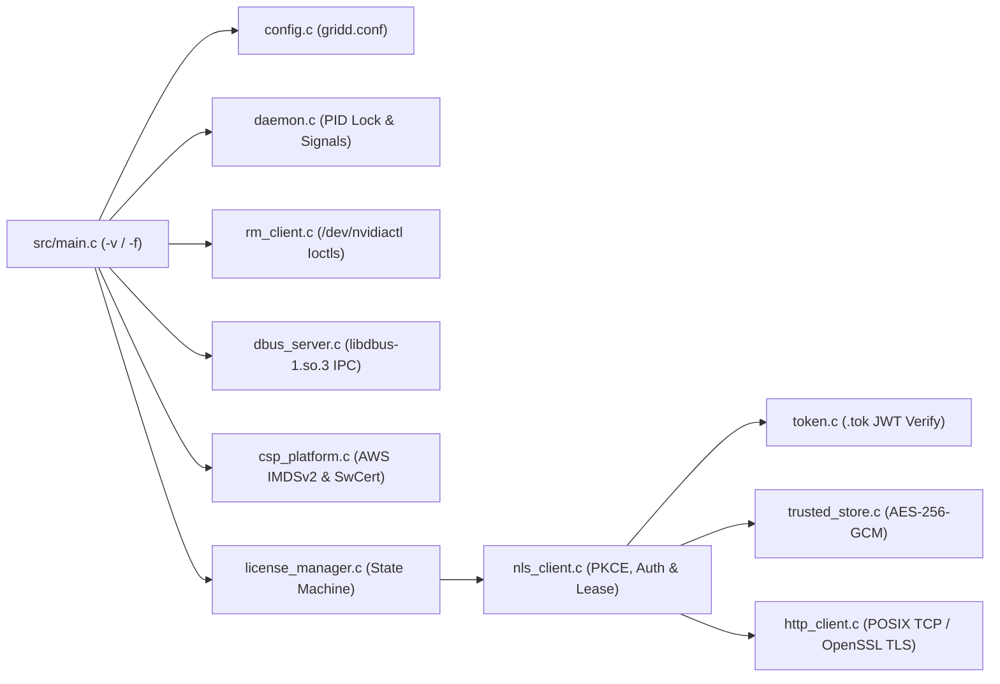

# `nvidia-gridd` Clean-Room Specification & C11 Implementation

A clean-room behavioral specification and idiomatic C11 Linux reimplementation of `nvidia-gridd` (the NVIDIA vGPU / GRID licensing daemon), derived strictly from behavioral observation of the binary's externally observable interfaces.

## System Architecture Overview



## Documentation Index
- [**Architecture Guide**](docs/ARCHITECTURE.md) — Layered module dependency graph, daemon lifecycle decision tree, concurrency/self-pipe IPC, License Manager `stateDiagram-v2`, and CMake/systemd packaging.
- [**Subsystem Flowcharts**](docs/FLOWCHARTS.md) — Detailed Mermaid sequence diagrams and flowcharts for NLS REST/PKCE leasing, `.tok` JWT verification, AES-256-GCM trusted store, RM `/dev/nvidiactl` ioctls, AWS IMDSv2, D-Bus IPC, and native HTTP/TLS + Proxy `CONNECT`.
- [**Method Call Graph**](docs/CALL_GRAPH.md) — Complete call-graph flowcharts and caller-to-callee matrix covering all `151` C functions across `src/*.c`.
- [**C11 API Reference**](docs/API_REFERENCE.md) — Exhaustive reference covering all 15 header/source modules under `include/gridd/` and `src/`, every type, enum, struct, constant, macro, and all `92` public `gridd_*` functions.
- [**Operations, Packaging & Testing Guide**](docs/OPERATIONS_AND_TESTING.md) — Dependencies, CMake/GCC/Clang builds, CPack (`.deb`/`.tar.gz`/`.rpm`) via `packaging/build-package.sh`, systemd deployment, `gridd.conf` keys, and the 3-tier verification pipeline.
- [**Project Handoff & Decisions**](docs/PROJECT_HANDOFF.md) — Clean-room boundaries, architectural decisions, Ubuntu build environment notes, workspace skill overview, and verified baseline status.
- [**Behavioral Specification**](docs/SPECIFICATION.md) — Clean-room protocol, ioctl ABI, configuration, cryptographic, and IPC specification.

## Repository Layout
- `include/gridd/` & `src/` — Modular C11 daemon implementation (`gridd_core` + `nvidia-gridd`) linking system OpenSSL 3.x (`OpenSSL::SSL`, `OpenSSL::Crypto`), POSIX threads/signals/sockets, and `dlopen("libdbus-1.so.3")`.
- `packaging/` — [`nvidia-gridd.service`](packaging/nvidia-gridd.service), [`gridd.conf.template`](packaging/gridd.conf.template), [`build-package.sh`](packaging/build-package.sh), and Debian maintainer hooks (`packaging/debian/postinst`, `packaging/debian/prerm`).
- `.agents/skills/build-and-package-gridd/` — Workspace skill and [`remote-package.ps1`](.agents/skills/build-and-package-gridd/scripts/remote-package.ps1) helper for remote Ubuntu compilation & CPack packaging from Windows.
- `tests/` — C11 unit tests (`c_unit_tests.c`), compiled C live integration harness (`c_e2e_tests.c` + `run_c_e2e.py`), mock NLS/IMDS servers, Python conformance tests (`test_cleanroom_spec.py`), and static clean-room audit (`test_c_static_audit.py`).

## Quick Start (Linux)
```bash
# Build & package (.deb + .tar.gz + SHA256SUMS) with all verification checks:
./packaging/build-package.sh --clean

# Or manual CMake build & test:
cmake -B build -DCMAKE_BUILD_TYPE=Release
cmake --build build -j
ctest --test-dir build --output-on-failure
python3 -B tests/run_c_e2e.py build/c_e2e_tests
```

## Conformance & Static Audit Tests (Windows or Linux)
```bash
python -B -m unittest discover -s tests -v
```
