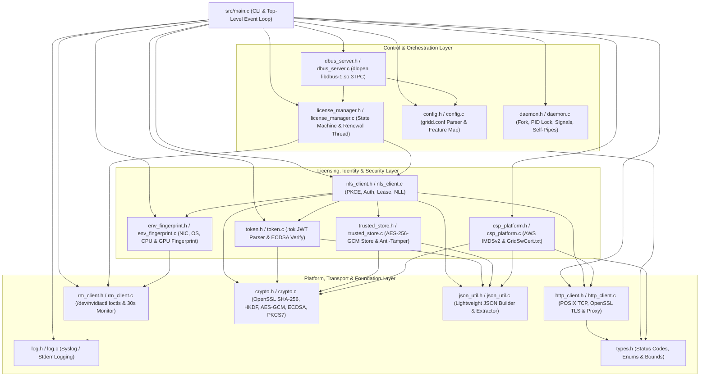
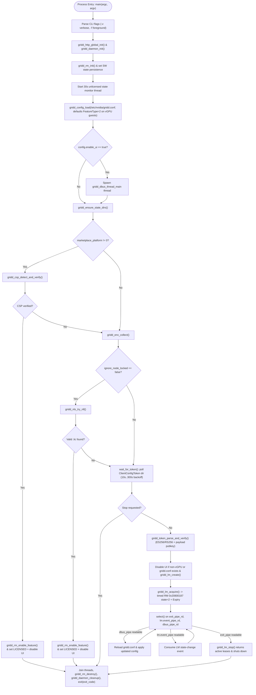
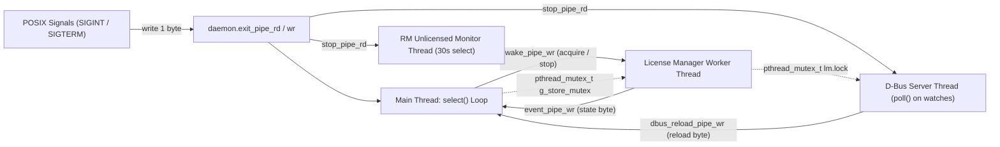
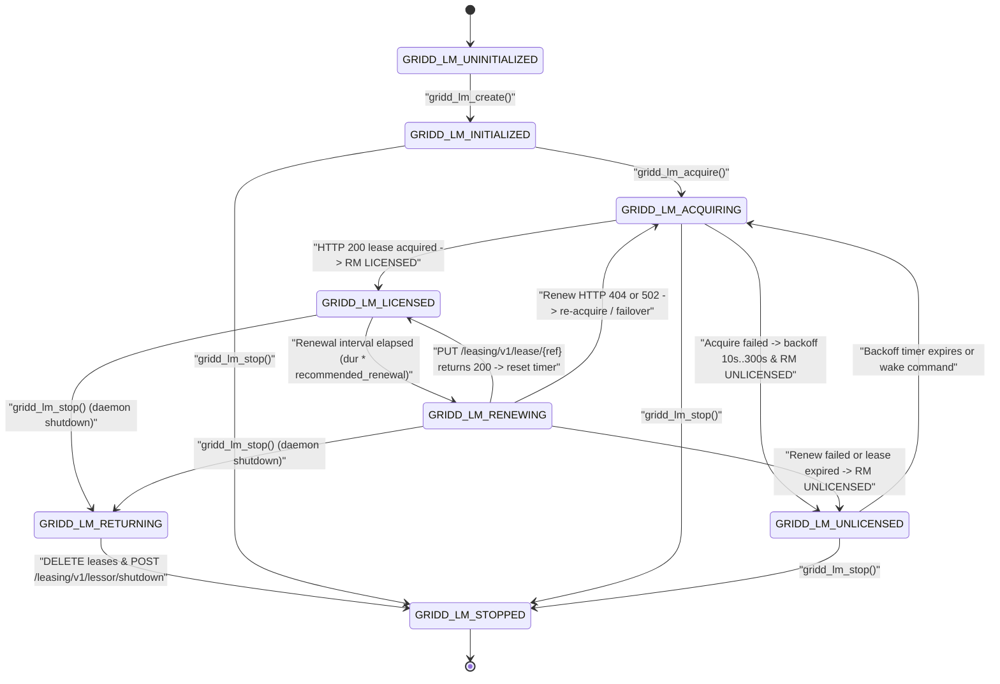

# `nvidia-gridd` Clean-Room Architecture

This document describes the modular software architecture, concurrency model, build targets, and licensing orchestration of the clean-room C11 `nvidia-gridd` implementation.

## 1. Layered Module Architecture

The codebase is organized into 15 modular header/source pairs under [`include/gridd/`](../include/gridd/) and [`src/`](../src/), compiled into a shared core library (`gridd_core`) and linked into the `nvidia-gridd` daemon binary ([`src/main.c`](../src/main.c)) as well as C unit and end-to-end test executables.

### Module Inventory

| Layer | Header / Source | Primary Responsibility |
| --- | --- | --- |
| Entry | `src/main.c` | Parses `-v` / `-f` CLI flags, initializes subsystems, enforces licensing priority (CSP -> NLL -> NLS `.tok`), and runs the main `select()` event loop. |
| Control | `daemon.h` / `daemon.c` | Handles POSIX daemonization (`umask(026)`, `fork()`, `setsid()`, `chdir("/")`), PID locking (`lockf(F_TLOCK)`), signal handling (`SIGINT`, `SIGTERM`, `SIGPIPE`), self-pipes, and state directories. |
| Control | `config.h` / `config.c` | Loads key-value pairs from `/etc/nvidia/gridd.conf`, disables UI atomically via temp file + `rename()`, and maps `FeatureType` to NLS product names. |
| Control | `license_manager.h` / `license_manager.c` | Runs the asynchronous background licensing thread managing lease acquisition, exponential backoff retries (10s to 300s), renewal timers, and graceful lease return. |
| Control | `dbus_server.h` / `dbus_server.c` | Dynamically loads `libdbus-1.so.3`, claims `nvidia.grid.server`, serves `GridLicenseState` IPC calls, and triggers config reload via self-pipe. |
| Licensing | `nls_client.h` / `nls_client.c` | Executes NLS REST flows (`/auth/v1/*`, `/leasing/v1/*`), handles HTTP 307 redirects, 401 token refresh, 409 origin conflicts, and parses offline Node-Locked Licenses (`.lic`). |
| Licensing | `token.h` / `token.c` | Discovers `.tok` client configuration tokens, splits JWT segments, verifies ES256/RS256 signatures against embedded NLS public keys, and checks `nbf`/`exp` bounds. |
| Licensing | `trusted_store.h` / `trusted_store.c` | Persists `store_nls.dat` and `store_nls.tag` encrypted with AES-256-GCM using an HKDF-SHA256 machine-UUID key; detects clock windback and fingerprint mismatches. |
| Licensing | `csp_platform.h` / `csp_platform.c` | Evaluates Cloud Service Provider entitlements across 6 marketplaces, runs AWS IMDSv2 signed document verification, and verifies `/etc/nvidia/GridSwCert.txt`. |
| Licensing | `env_fingerprint.h` / `env_fingerprint.c` | Collects NIC MAC/IP addresses, hostname, `/etc/os-release`, `/proc/cpuinfo` topology, `/sys/class/dmi/id/product_uuid` / `/etc/machine-id`, and GPU PCI IDs. |
| Platform | `rm_client.h` / `rm_client.c` | Opens `/dev/nvidiactl`, allocates RM client/device/subdevice/vGPU handles, invokes `NV_ESC_RM_*` ioctls, updates GPU license status, and runs the 30s unlicensed monitor thread. |
| Platform | `http_client.h` / `http_client.c` | Implements non-Libcurl HTTP/1.1 client over POSIX `getaddrinfo`/`socket` with `SO_RCVTIMEO`/`SO_SNDTIMEO`, OpenSSL 3.x TLS 1.2+ with SNI, chunked decoding, and HTTP `CONNECT` proxy tunneling. |
| Platform | `crypto.h` / `crypto.c` | Wraps OpenSSL EVP primitives: Base64/Base64URL, SHA-256, CSPRNG, PKCE S256, HKDF-SHA256, HMAC-SHA256, AES-256-GCM, JWT splitting, PEM verification, and PKCS#7 verification. |
| Platform | `json_util.h` / `json_util.c` | Provides overflow-guarded dynamic string buffer JSON assembly and zero-allocation scalar/raw extraction helpers. |
| Platform | `log.h` / `log.c` | Abstracts `openlog`/`syslog` vs. `stderr` logging controlled by `-f` and `-v`. |
| Platform | `types.h` | Defines `gridd_status_t`, `gridd_feature_type_t`, `gridd_lm_state_t`, `gridd_rm_license_state_t`, and buffer bounds (`GRIDD_MAX_*`). |

## 2. Master Daemon Lifecycle & Licensing Decision Flow

Upon startup in [`src/main.c`](../src/main.c), the daemon progresses deterministically through initialization, entitlement resolution (CSP Marketplace -> Node-Locked License -> NLS `.tok` Lease), and main-loop event dispatch.

## 3. Concurrency Model & Self-Pipe IPC

The daemon uses up to four concurrent threads coordinated strictly by mutexes and POSIX self-pipes so `select()` / `poll()` loops remain non-blocking and async-signal-safe shutdown propagates immediately:

| Thread | Entry Point | Synchronization & Wake Mechanism | Blocking Primitive |
| --- | --- | --- | --- |
| **Main Thread** | `main()` in `src/main.c` | Owns `gridd_daemon_ctx_t`, `gridd_rm_client_t`, `gridd_license_manager_t`; consumes `exit_pipe_rd`, `lm.event_pipe_rd`, `dbus_pipe_rd` | `select()` |
| **License Manager Worker** | `lm_worker_main()` in `src/license_manager.c` | Reads commands from `wake_pipe_rd` under `lm.lock`; emits 1-byte notifications on `event_pipe_wr` | `select()` with `retry_interval_ms` / `renew_interval_ms` timeout |
| **D-Bus IPC Thread** | `gridd_dbus_thread_main()` in `src/dbus_server.c` | Reads `gridd_license_manager_t` state via thread-safe accessors; writes reload events to `dbus_reload_pipe_wr` | `poll()` across D-Bus watch FDs + `stop_pipe_rd` |
| **RM Unlicensed Monitor** | `rm_unlicensed_monitor_main()` in `src/rm_client.c` | Polls `/proc/driver/nvidia` and `NV2080_CTRL_CMD_GPU_GET_UNLICENSED_STATE`; exits when `stop_pipe_rd` becomes readable | `select()` with 30-second timeout |

## 4. License Manager State Machine

`gridd_lm_state_t` drives both NLS network operations and RM GPU license status updates inside `src/license_manager.c`:

## 5. Build System & Packaging

Defined in [`Makefile`](../Makefile) (repository integration & guest/CI builds) and [`CMakeLists.txt`](../CMakeLists.txt):
- **Standard & Flags:** C11 with `-Wall -Wextra -Werror -Wpedantic` (and `-D_POSIX_C_SOURCE=200809L`).
- **Makefile Targets:**
  - `make`: builds `nvidia-gridd`, `c_unit_tests`, and `c_e2e_tests` against OpenSSL 3.x (`libssl`/`libcrypto`), `pthread`, and `dl`.
  - `make install`: installs the daemon to `$(DESTDIR)$(PREFIX)/bin/nvidia-gridd` (default `/usr/bin/nvidia-gridd`) for drop-in `provision_linux_vgpu_guest.sh` and RPM/DEB/systemd replacement.
  - `make test`: executes `c_unit_tests`, `tests/run_c_e2e.py`, and `tests/test_c_static_audit.py`.
- **CMake Targets:**
  - `gridd_core` (`STATIC`): 14 library translation units under `src/` (excluding `src/main.c`). Links `OpenSSL::SSL`, `OpenSSL::Crypto`, `Threads::Threads`, `${CMAKE_DL_LIBS}`.
  - `nvidia-gridd` (`EXECUTABLE`): `src/main.c` linked against `gridd_core`. Installed to `sbin` (when packaged via CMake).
  - `c_unit_tests` (`EXECUTABLE`): [`tests/c_unit_tests.c`](../tests/c_unit_tests.c) linked against `gridd_core`; registered with CTest (`gridd_c_unit_tests`).
  - `c_e2e_tests` (`EXECUTABLE`): [`tests/c_e2e_tests.c`](../tests/c_e2e_tests.c) linked against `gridd_core`; driven by [`tests/run_c_e2e.py`](../tests/run_c_e2e.py).
- **Packaging Files:**
  - [`packaging/nvidia-gridd.service`](../packaging/nvidia-gridd.service) -> installed to `lib/systemd/system/nvidia-gridd.service` (`Type=forking`, `PIDFile=/var/run/nvidia-gridd/nvidia-gridd.pid`, `ExecStart=/usr/sbin/nvidia-gridd`, `Restart=on-failure`, `RestartSec=5`).
  - [`packaging/gridd.conf.template`](../packaging/gridd.conf.template) -> installed to `share/nvidia/gridd.conf.template` (provides default `FeatureType=2`, `EnableUI=TRUE`, `ClientConfigTokenPath=/etc/nvidia/ClientConfigToken`, and documented optional settings).
