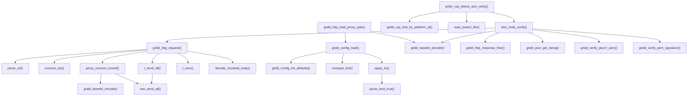
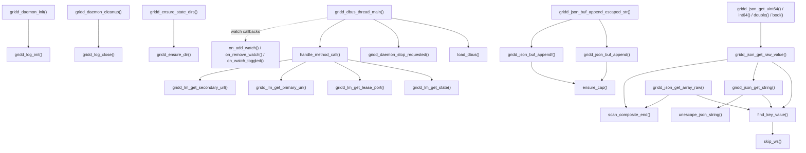

# `nvidia-gridd` Clean-Room Method & Function Call Graph

Complete static call-graph reference covering all **151** functions (`92` public `gridd_*` APIs, `58` module-internal `static` helpers, and `main()`) across all 15 C11 translation units in [`src/`](../src/).

---

## 1. Master Entry & Thread Orchestration Call Graph

Shows top-level calls from `main()` in [`src/main.c`](../src/main.c), background thread entry points (`gridd_dbus_thread_main`, `unlicensed_monitor_thread`, `lm_worker_main`), and startup/shutdown flow.

```mermaid
flowchart TD
    Main["main() [src/main.c]"] --> HttpInit["gridd_http_global_init()"]
    Main --> DaemonInit["gridd_daemon_init()"]
    DaemonInit --> LogInit["gridd_log_init()"]
    Main --> RmInit["gridd_rm_init()"]
    Main --> RmPersist["gridd_rm_set_sw_persistence()"]
    Main --> RmMon["gridd_rm_start_unlicensed_monitor()"]
    RmMon --> RmQueryFeat["gridd_rm_query_features()"]
    RmMon -. "pthread_create" .-> UnlicThr["unlicensed_monitor_thread()"]
    UnlicThr --> RmUnlic["gridd_rm_get_unlicensed_state()"]
    UnlicThr --> ProcCheck["nvidia_proc_present()"]

    Main --> CfgLoad["gridd_config_load()"]
    Main -. "pthread_create (EnableUI)" .-> DBusThr["gridd_dbus_thread_main()"]
    Main --> EnsureDirs["gridd_ensure_state_dirs()"]

    Main --> CheckCSP["gridd_csp_detect_and_verify()"]
    Main --> EnvCollect["gridd_env_collect()"]
    Main --> TryNLL["gridd_nls_try_nll()"]
    Main --> TokFind["gridd_token_find_file()"]
    Main --> WaitTok["wait_for_token()"]
    WaitTok --> TokFind
    WaitTok --> StopReq["gridd_daemon_stop_requested()"]

    Main --> TokVerify["gridd_token_parse_and_verify()"]
    Main --> DisableUI["gridd_config_disable_ui()"]
    Main --> LoadProxy["gridd_http_load_proxy_opts()"]
    Main --> LmCreate["gridd_lm_create()"]
    LmCreate -. "pthread_create" .-> LmWorker["lm_worker_main()"]

    Main --> SelProd["select_product_for_feature()"]
    SelProd --> RmQueryFeat
    SelProd --> RmSupports["gridd_rm_gpu_supports_feature()"]
    SelProd --> FeatName["gridd_feature_to_product_name()"]

    Main --> LmAcquire["gridd_lm_acquire()"]
    Main --> DrainPipe["drain_pipe()"]
    Main --> LmState["gridd_lm_get_state()"]
    Main --> LmExp["gridd_lm_get_expiry_and_rm_state()"]
    Main --> MapFeat["gridd_map_feature_type()"]
    Main --> RmEnable["gridd_rm_enable_feature()"]
    Main --> RmStatus["gridd_rm_set_license_status()"]

    Main --> LmDestroy["gridd_lm_destroy()"]
    Main --> RmDestroy["gridd_rm_destroy()"]
    Main --> DaemonClean["gridd_daemon_cleanup()"]
    DaemonClean --> LogClose["gridd_log_close()"]
    Main --> HttpClean["gridd_http_global_cleanup()"]
```

---

## 2. License Manager & NLS Protocol Method Call Flowchart

Exact call hierarchy between [`src/license_manager.c`](../src/license_manager.c) and [`src/nls_client.c`](../src/nls_client.c):

```mermaid
flowchart TD
    LmCreate["gridd_lm_create()"] --> NlsInit["gridd_nls_init()"]
    LmCreate --> LmDestroy["gridd_lm_destroy()"]
    LmDestroy --> LmStop["gridd_lm_stop()"]
    LmAcquire["gridd_lm_acquire()"] --> WriteSig["write_pipe_sig()"]
    LmStop --> WriteSig
    LmStop --> NlsReturn["gridd_nls_return_leases()"]

    LmWorker["lm_worker_main()"] --> SetNotify["set_state_and_notify()"]
    SetNotify --> WriteSig
    LmWorker --> UpdateInt["update_intervals_from_lease()"]
    LmWorker --> NlsAcq["gridd_nls_acquire_lease()"]
    LmWorker --> NlsRen["gridd_nls_renew_lease()"]
    LmWorker --> NlsReturn

    NlsInit --> StoreOpen["gridd_trusted_store_open()"]
    NlsInit --> StoreMatch["gridd_trusted_store_match_fingerprint()"]
    NlsInit --> StoreSave["gridd_trusted_store_save()"]

    NlsAcq --> BuildProp["gridd_nls_build_lease_proposal_json()"]
    NlsAcq --> LeasedReq["leased_request()"]
    NlsAcq --> ParseLease["gridd_nls_parse_lease_response()"]
    NlsAcq --> FmtIso["gridd_format_utc_iso8601()"]
    NlsAcq --> StoreSave
    NlsAcq --> HttpFree["gridd_http_response_free()"]

    NlsRen --> LeasedReq
    NlsRen --> ParseLease
    NlsRen --> FmtIso
    NlsRen --> StoreSave
    NlsRen --> HttpFree

    NlsGet["gridd_nls_get_active_leases()"] --> LeasedReq
    NlsGet --> JsonArr["gridd_json_get_array_raw()"]
    NlsGet --> HttpFree

    NlsReturn --> LeasedReq
    NlsReturn --> StoreSave
    NlsReturn --> HttpFree

    NlsShut["gridd_nls_shutdown()"] --> LeasedReq
    NlsShut --> HttpFree

    LeasedReq --> BaseUrl["build_base_url()"]
    LeasedReq --> HttpReq["gridd_http_request()"]
    LeasedReq --> NlsAuth["gridd_nls_authenticate()"]
    LeasedReq --> RedirNode["handle_redirect_node()"]
    LeasedReq --> MapHttp["map_http_status()"]
    LeasedReq --> HttpFree

    NlsAuth --> NlsReg["gridd_nls_register_or_update_origin()"]
    NlsAuth --> Pkce["gridd_pkce_generate()"]
    NlsAuth --> BaseUrl
    NlsAuth --> HttpReq
    NlsAuth --> ParseIso["gridd_parse_utc_iso8601()"]
    NlsAuth --> MapHttp
    NlsAuth --> HttpFree

    NlsReg --> BaseUrl
    NlsReg --> BuildEnv["build_environment_object()"]
    NlsReg --> HttpReq
    NlsReg --> StoreSave
    NlsReg --> MapHttp
    NlsReg --> HttpFree

    NlsTryNll["gridd_nls_try_nll()"] --> CfgLoad2["gridd_config_load()"]
    NlsTryNll --> ParseIso
```

---

## 3. Trusted Store, Token & Crypto Method Call Flowchart

Exact call hierarchy across [`src/trusted_store.c`](../src/trusted_store.c), [`src/token.c`](../src/token.c), and [`src/crypto.c`](../src/crypto.c):

```mermaid
flowchart TD
    StoreOpen["gridd_trusted_store_open()"] --> EnsureDir["gridd_ensure_dir()"]
    StoreOpen --> DeriveKey["derive_store_key()"]
    DeriveKey --> Hkdf["gridd_hkdf_sha256()"]
    StoreOpen --> LoadEnc["load_encrypted_store()"]
    LoadEnc --> AesDec["gridd_aes256_gcm_decrypt()"]
    AesDec --> LogOssl["log_ossl_err()"]
    LoadEnc --> DeserJson["deserialize_store_json()"]
    StoreOpen --> CheckClk["gridd_trusted_store_check_clock()"]
    CheckClk --> ParseIso2["gridd_parse_utc_iso8601()"]
    StoreOpen --> FmtIso2["gridd_format_utc_iso8601()"]
    StoreOpen --> StoreSave2["gridd_trusted_store_save()"]

    StoreSave2 --> SerJson["serialize_store_json()"]
    StoreSave2 --> RandBytes["gridd_random_bytes()"]
    StoreSave2 --> AesEnc["gridd_aes256_gcm_encrypt()"]
    AesEnc --> LogOssl
    StoreSave2 --> WriteAtom["write_atomic_bytes()"]
    StoreSave2 --> JsonFree["gridd_json_buf_free()"]

    TokVerify2["gridd_token_parse_and_verify()"] --> TokFind2["gridd_token_find_file()"]
    TokFind2 --> EndsTok["ends_with_tok()"]
    TokVerify2 --> JwtSplit["gridd_jwt_split()"]
    TokVerify2 --> B64Dec["gridd_base64_decode()"]
    TokVerify2 --> VerPem["gridd_verify_pem_signature()"]
    VerPem --> LogOssl
    TokVerify2 --> ParseUrls["parse_node_urls()"]

    Pkce2["gridd_pkce_generate()"] --> RandBytes
    Pkce2 --> Sha256["gridd_sha256()"]
    Pkce2 --> B64Enc["gridd_base64_encode()"]
    VerPkcs7["gridd_verify_pkcs7_pem()"] --> LogOssl
```

---

## 4. HTTP/TLS Transport, CSP IMDSv2 & Config Method Call Flowchart

Exact call hierarchy across [`src/http_client.c`](../src/http_client.c), [`src/csp_platform.c`](../src/csp_platform.c), and [`src/config.c`](../src/config.c):

---

## 5. NVIDIA RM Client & Environment Fingerprint Method Call Flowchart

Exact call hierarchy across [`src/rm_client.c`](../src/rm_client.c) and [`src/env_fingerprint.c`](../src/env_fingerprint.c):

```mermaid
flowchart TD
    RmDefOps["gridd_rm_default_ops()"] -. "binds ops table" .-> DefOpen["default_open_ctl() / default_close_ctl()"]
    RmDefOps -. "binds ops table" .-> DefIoctls["default_rm_alloc() / default_rm_free() / default_rm_control()"]

    RmInit2["gridd_rm_init()"] --> RmAlloc["rm_alloc()"]
    RmInit2 --> RmCtrl["rm_ctrl()"]
    RmInit2 --> RmDestroy2["gridd_rm_destroy()"]

    RmPersist2["gridd_rm_set_sw_persistence()"] --> RmCtrl
    RmQFeat["gridd_rm_query_features()"] --> RmCtrl
    RmQPci["gridd_rm_query_pci_ids()"] --> RmCtrl
    RmCsp["gridd_rm_get_csp_id()"] --> RmCtrl
    RmTelem["gridd_rm_get_telemetry()"] --> RmCtrl
    RmUnlic2["gridd_rm_get_unlicensed_state()"] --> RmCtrl
    RmSupp["gridd_rm_gpu_supports_feature()"] --> RmCtrl
    RmEnable2["gridd_rm_enable_feature()"] --> RmSupp
    RmEnable2 --> RmCtrl
    RmStatus2["gridd_rm_set_license_status()"] --> RmSupp
    RmStatus2 --> RmCtrl
    RmDisable["gridd_rm_disable_feature()"] --> RmSupp
    RmDisable --> RmCtrl

    RmMon2["gridd_rm_start_unlicensed_monitor()"] --> RmQFeat
    UnlicThr2["unlicensed_monitor_thread()"] --> StopReq2["gridd_daemon_stop_requested()"]
    UnlicThr2 --> ProcPres["nvidia_proc_present()"]
    UnlicThr2 --> RmInit2
    UnlicThr2 --> RmUnlic2
    UnlicThr2 --> RmDestroy2

    EnvCol["gridd_env_collect()"] --> CollectNet["collect_network_info()"]
    CollectNet --> CsvHas["csv_contains()"]
    CollectNet --> CsvApp["append_quoted_csv()"]
    EnvCol --> ParseOS["parse_os_release()"]
    EnvCol --> ReadCPU["read_cpu_topology()"]
    EnvCol --> RmTelem
    EnvCol --> RmQPci
    EnvCol --> CsvApp
    EnvCol --> ReadUUID["gridd_env_read_machine_uuid()"]
    ReadUUID --> ReadTrim["read_trimmed_file()"]
```

---

## 6. Daemon Lifecycle, D-Bus IPC, Logging & JSON Utility Call Flowchart

Exact call hierarchy across [`src/daemon.c`](../src/daemon.c), [`src/dbus_server.c`](../src/dbus_server.c), [`src/log.c`](../src/log.c), and [`src/json_util.c`](../src/json_util.c):

---

## 7. Complete Function Call Matrix (All 151 Functions)

Leaf functions perform no intra-project function calls outside standard library / POSIX / OpenSSL / `dlopen` APIs.

### `src/main.c` (4 functions)
| Function | Scope | Direct Internal Callees |
| --- | --- | --- |
| `select_product_for_feature` | `static` | `gridd_feature_to_product_name`, `gridd_rm_gpu_supports_feature`, `gridd_rm_query_features` |
| `drain_pipe` | `static` | *(leaf)* |
| `wait_for_token` | `static` | `gridd_daemon_stop_requested`, `gridd_token_find_file` |
| `main` | `public` | `drain_pipe`, `gridd_config_disable_ui`, `gridd_config_load`, `gridd_csp_detect_and_verify`, `gridd_daemon_cleanup`, `gridd_daemon_init`, `gridd_daemon_stop_requested`, `gridd_ensure_state_dirs`, `gridd_env_collect`, `gridd_http_global_cleanup`, `gridd_http_global_init`, `gridd_http_load_proxy_opts`, `gridd_lm_acquire`, `gridd_lm_create`, `gridd_lm_destroy`, `gridd_lm_get_expiry_and_rm_state`, `gridd_lm_get_state`, `gridd_map_feature_type`, `gridd_nls_try_nll`, `gridd_rm_destroy`, `gridd_rm_enable_feature`, `gridd_rm_init`, `gridd_rm_set_license_status`, `gridd_rm_set_sw_persistence`, `gridd_rm_start_unlicensed_monitor`, `gridd_token_find_file`, `gridd_token_parse_and_verify`, `select_product_for_feature`, `wait_for_token` |

### `src/license_manager.c` (13 functions)
| Function | Scope | Direct Internal Callees |
| --- | --- | --- |
| `write_pipe_sig` | `static` | *(leaf)* |
| `update_intervals_from_lease` | `static` | *(leaf)* |
| `set_state_and_notify` | `static` | `write_pipe_sig` |
| `lm_worker_main` | `static` | `gridd_nls_acquire_lease`, `gridd_nls_renew_lease`, `gridd_nls_return_leases`, `set_state_and_notify`, `update_intervals_from_lease` |
| `gridd_lm_create` | `public` | `gridd_lm_destroy`, `gridd_nls_init` |
| `gridd_lm_acquire` | `public` | `write_pipe_sig` |
| `gridd_lm_stop` | `public` | `gridd_nls_return_leases`, `write_pipe_sig` |
| `gridd_lm_destroy` | `public` | `gridd_lm_stop` |
| `gridd_lm_get_state` | `public` | *(leaf)* |
| `gridd_lm_get_expiry_and_rm_state` | `public` | *(leaf)* |
| `gridd_lm_get_lease_port` | `public` | *(leaf)* |
| `gridd_lm_get_primary_url` | `public` | *(leaf)* |
| `gridd_lm_get_secondary_url` | `public` | *(leaf)* |

### `src/nls_client.c` (16 functions)
| Function | Scope | Direct Internal Callees |
| --- | --- | --- |
| `build_base_url` | `static` | *(leaf)* |
| `build_environment_object` | `static` | `gridd_json_buf_append`, `gridd_json_buf_append_escaped_str`, `gridd_json_buf_appendf` |
| `map_http_status` | `static` | `gridd_json_get_string` |
| `handle_redirect_node` | `static` | `gridd_json_get_string` |
| `leased_request` | `static` | `build_base_url`, `gridd_http_request`, `gridd_http_response_free`, `gridd_nls_authenticate`, `handle_redirect_node`, `map_http_status` |
| `gridd_nls_init` | `public` | `gridd_trusted_store_match_fingerprint`, `gridd_trusted_store_open`, `gridd_trusted_store_save` |
| `gridd_nls_register_or_update_origin` | `public` | `build_base_url`, `build_environment_object`, `gridd_http_request`, `gridd_http_response_free`, `gridd_json_buf_append`, `gridd_json_buf_append_escaped_str`, `gridd_json_buf_appendf`, `gridd_json_buf_free`, `gridd_json_buf_init`, `gridd_json_get_string`, `gridd_trusted_store_save`, `map_http_status` |
| `gridd_nls_authenticate` | `public` | `build_base_url`, `gridd_http_request`, `gridd_http_response_free`, `gridd_json_buf_append`, `gridd_json_buf_append_escaped_str`, `gridd_json_buf_free`, `gridd_json_buf_init`, `gridd_json_get_string`, `gridd_nls_register_or_update_origin`, `gridd_parse_utc_iso8601`, `gridd_pkce_generate`, `map_http_status` |
| `gridd_nls_build_lease_proposal_json` | `public` | `gridd_json_buf_append`, `gridd_json_buf_append_escaped_str`, `gridd_json_buf_appendf`, `gridd_json_buf_free`, `gridd_json_buf_init` |
| `gridd_nls_parse_lease_response` | `public` | `gridd_json_get_bool`, `gridd_json_get_double`, `gridd_json_get_string`, `gridd_json_get_uint64`, `gridd_parse_utc_iso8601` |
| `gridd_nls_acquire_lease` | `public` | `gridd_format_utc_iso8601`, `gridd_http_response_free`, `gridd_nls_build_lease_proposal_json`, `gridd_nls_parse_lease_response`, `gridd_trusted_store_save`, `leased_request` |
| `gridd_nls_renew_lease` | `public` | `gridd_format_utc_iso8601`, `gridd_http_response_free`, `gridd_nls_parse_lease_response`, `gridd_trusted_store_save`, `leased_request` |
| `gridd_nls_get_active_leases` | `public` | `gridd_http_response_free`, `gridd_json_get_array_raw`, `leased_request` |
| `gridd_nls_return_leases` | `public` | `gridd_http_response_free`, `gridd_trusted_store_save`, `leased_request` |
| `gridd_nls_shutdown` | `public` | `gridd_http_response_free`, `leased_request` |
| `gridd_nls_try_nll` | `public` | `gridd_config_load`, `gridd_json_get_string`, `gridd_json_get_uint64`, `gridd_parse_utc_iso8601` |

### `src/rm_client.c` (23 functions)
| Function | Scope | Direct Internal Callees |
| --- | --- | --- |
| `default_open_ctl` | `static` | *(leaf)* |
| `default_close_ctl` | `static` | *(leaf)* |
| `default_rm_alloc` | `static` | *(leaf)* |
| `default_rm_free` | `static` | *(leaf)* |
| `default_rm_control` | `static` | *(leaf)* |
| `rm_ctrl` | `static` | *(leaf)* |
| `rm_alloc` | `static` | *(leaf)* |
| `nvidia_proc_present` | `static` | *(leaf)* |
| `unlicensed_monitor_thread` | `static` | `gridd_daemon_stop_requested`, `gridd_rm_destroy`, `gridd_rm_get_unlicensed_state`, `gridd_rm_init`, `nvidia_proc_present` |
| `gridd_rm_default_ops` | `public` | *(leaf)* |
| `gridd_rm_init` | `public` | `gridd_rm_destroy`, `rm_alloc`, `rm_ctrl` |
| `gridd_rm_destroy` | `public` | *(leaf)* |
| `gridd_rm_set_sw_persistence` | `public` | `rm_ctrl` |
| `gridd_rm_query_features` | `public` | `rm_ctrl` |
| `gridd_rm_gpu_supports_feature` | `public` | `rm_ctrl` |
| `gridd_rm_query_pci_ids` | `public` | `rm_ctrl` |
| `gridd_rm_get_csp_id` | `public` | `rm_ctrl` |
| `gridd_rm_enable_feature` | `public` | `gridd_rm_gpu_supports_feature`, `rm_ctrl` |
| `gridd_rm_set_license_status` | `public` | `gridd_rm_gpu_supports_feature`, `rm_ctrl` |
| `gridd_rm_disable_feature` | `public` | `gridd_rm_gpu_supports_feature`, `rm_ctrl` |
| `gridd_rm_get_telemetry` | `public` | `rm_ctrl` |
| `gridd_rm_get_unlicensed_state` | `public` | `rm_ctrl` |
| `gridd_rm_start_unlicensed_monitor` | `public` | `gridd_rm_query_features` |

### `src/trusted_store.c` (11 functions)
| Function | Scope | Direct Internal Callees |
| --- | --- | --- |
| `derive_store_key` | `static` | `gridd_hkdf_sha256` |
| `serialize_store_json` | `static` | `gridd_json_buf_append`, `gridd_json_buf_append_escaped_str`, `gridd_json_buf_appendf`, `gridd_json_buf_init` |
| `deserialize_store_json` | `static` | `gridd_json_get_array_raw`, `gridd_json_get_bool`, `gridd_json_get_string`, `gridd_json_get_uint64` |
| `write_atomic_bytes` | `static` | *(leaf)* |
| `load_encrypted_store` | `static` | `deserialize_store_json`, `gridd_aes256_gcm_decrypt` |
| `gridd_format_utc_iso8601` | `public` | *(leaf)* |
| `gridd_parse_utc_iso8601` | `public` | *(leaf)* |
| `gridd_trusted_store_open` | `public` | `derive_store_key`, `gridd_ensure_dir`, `gridd_format_utc_iso8601`, `gridd_trusted_store_check_clock`, `gridd_trusted_store_save`, `load_encrypted_store` |
| `gridd_trusted_store_save` | `public` | `gridd_aes256_gcm_encrypt`, `gridd_json_buf_free`, `gridd_random_bytes`, `serialize_store_json`, `write_atomic_bytes` |
| `gridd_trusted_store_check_clock` | `public` | `gridd_parse_utc_iso8601` |
| `gridd_trusted_store_match_fingerprint` | `public` | *(leaf)* |

### `src/http_client.c` (12 functions)
| Function | Scope | Direct Internal Callees |
| --- | --- | --- |
| `parse_url` | `static` | *(leaf)* |
| `connect_tcp` | `static` | *(leaf)* |
| `raw_send_all` | `static` | *(leaf)* |
| `t_send_all` | `static` | `raw_send_all` |
| `t_recv` | `static` | *(leaf)* |
| `proxy_connect_tunnel` | `static` | `gridd_base64_encode`, `raw_send_all` |
| `decode_chunked_body` | `static` | *(leaf)* |
| `gridd_http_global_init` | `public` | *(leaf)* |
| `gridd_http_global_cleanup` | `public` | *(leaf)* |
| `gridd_http_response_free` | `public` | *(leaf)* |
| `gridd_http_load_proxy_opts` | `public` | `gridd_base64_decode`, `gridd_config_load` |
| `gridd_http_request` | `public` | `connect_tcp`, `decode_chunked_body`, `parse_url`, `proxy_connect_tunnel`, `t_recv`, `t_send_all` |

### `src/crypto.c` (13 functions)
| Function | Scope | Direct Internal Callees |
| --- | --- | --- |
| `log_ossl_err` | `static` | *(leaf)* |
| `gridd_base64_encode` | `public` | *(leaf)* |
| `gridd_base64_decode` | `public` | *(leaf)* |
| `gridd_sha256` | `public` | *(leaf)* |
| `gridd_random_bytes` | `public` | *(leaf)* |
| `gridd_pkce_generate` | `public` | `gridd_base64_encode`, `gridd_random_bytes`, `gridd_sha256` |
| `gridd_hkdf_sha256` | `public` | *(leaf)* |
| `gridd_hmac_sha256` | `public` | *(leaf)* |
| `gridd_aes256_gcm_encrypt` | `public` | `log_ossl_err` |
| `gridd_aes256_gcm_decrypt` | `public` | `log_ossl_err` |
| `gridd_jwt_split` | `public` | *(leaf)* |
| `gridd_verify_pem_signature` | `public` | `log_ossl_err` |
| `gridd_verify_pkcs7_pem` | `public` | `log_ossl_err` |

### `src/json_util.c` (17 functions)
| Function | Scope | Direct Internal Callees |
| --- | --- | --- |
| `ensure_cap` | `static` | *(leaf)* |
| `skip_ws` | `static` | *(leaf)* |
| `find_key_value` | `static` | `skip_ws` |
| `unescape_json_string` | `static` | *(leaf)* |
| `scan_composite_end` | `static` | *(leaf)* |
| `gridd_json_buf_init` | `public` | *(leaf)* |
| `gridd_json_buf_free` | `public` | *(leaf)* |
| `gridd_json_buf_append` | `public` | `ensure_cap` |
| `gridd_json_buf_appendf` | `public` | `ensure_cap` |
| `gridd_json_buf_append_escaped_str` | `public` | `gridd_json_buf_append`, `gridd_json_buf_appendf` |
| `gridd_json_get_string` | `public` | `find_key_value`, `unescape_json_string` |
| `gridd_json_get_raw_value` | `public` | `find_key_value`, `gridd_json_get_string`, `scan_composite_end` |
| `gridd_json_get_array_raw` | `public` | `find_key_value`, `scan_composite_end` |
| `gridd_json_get_uint64` | `public` | `gridd_json_get_raw_value` |
| `gridd_json_get_int64` | `public` | `gridd_json_get_raw_value` |
| `gridd_json_get_double` | `public` | `gridd_json_get_raw_value` |
| `gridd_json_get_bool` | `public` | `gridd_json_get_raw_value` |

### `src/config.c` (8 functions)
| Function | Scope | Direct Internal Callees |
| --- | --- | --- |
| `parse_bool_true` | `static` | *(leaf)* |
| `compact_line` | `static` | *(leaf)* |
| `apply_kv` | `static` | `parse_bool_true` |
| `gridd_config_init_defaults` | `public` | *(leaf)* |
| `gridd_config_load` | `public` | `apply_kv`, `compact_line`, `gridd_config_init_defaults` |
| `gridd_config_disable_ui` | `public` | *(leaf)* |
| `gridd_feature_to_product_name` | `public` | *(leaf)* |
| `gridd_map_feature_type` | `public` | *(leaf)* |

### `src/daemon.c` (8 functions)
| Function | Scope | Direct Internal Callees |
| --- | --- | --- |
| `signal_handler` | `static` | *(leaf)* |
| `gridd_daemon_stop_requested` | `public` | *(leaf)* |
| `gridd_daemon_request_stop` | `public` | *(leaf)* |
| `gridd_ensure_dir` | `public` | *(leaf)* |
| `gridd_ensure_state_dirs` | `public` | `gridd_ensure_dir` |
| `gridd_daemon_signal_dbus_reload` | `public` | *(leaf)* |
| `gridd_daemon_init` | `public` | `gridd_log_init` |
| `gridd_daemon_cleanup` | `public` | `gridd_log_close` |

### `src/env_fingerprint.c` (8 functions)
| Function | Scope | Direct Internal Callees |
| --- | --- | --- |
| `append_quoted_csv` | `static` | *(leaf)* |
| `csv_contains` | `static` | *(leaf)* |
| `collect_network_info` | `static` | `append_quoted_csv`, `csv_contains` |
| `parse_os_release` | `static` | *(leaf)* |
| `read_cpu_topology` | `static` | *(leaf)* |
| `read_trimmed_file` | `static` | *(leaf)* |
| `gridd_env_read_machine_uuid` | `public` | `read_trimmed_file` |
| `gridd_env_collect` | `public` | `append_quoted_csv`, `collect_network_info`, `gridd_env_read_machine_uuid`, `gridd_rm_get_telemetry`, `gridd_rm_query_pci_ids`, `parse_os_release`, `read_cpu_topology` |

### `src/dbus_server.c` (6 functions)
| Function | Scope | Direct Internal Callees |
| --- | --- | --- |
| `on_add_watch` | `static` | *(leaf)* |
| `on_remove_watch` | `static` | *(leaf)* |
| `on_watch_toggled` | `static` | *(leaf)* |
| `load_dbus` | `static` | *(leaf)* |
| `handle_method_call` | `static` | `gridd_lm_get_lease_port`, `gridd_lm_get_primary_url`, `gridd_lm_get_secondary_url`, `gridd_lm_get_state` |
| `gridd_dbus_thread_main` | `public` | `gridd_daemon_stop_requested`, `handle_method_call`, `load_dbus` |

### `src/csp_platform.c` (4 functions)
| Function | Scope | Direct Internal Callees |
| --- | --- | --- |
| `read_swcert_file` | `static` | *(leaf)* |
| `aws_imds_verify` | `static` | `gridd_base64_decode`, `gridd_http_request`, `gridd_http_response_free`, `gridd_json_get_string`, `gridd_verify_pem_signature`, `gridd_verify_pkcs7_pem` |
| `gridd_csp_find_by_platform_id` | `public` | *(leaf)* |
| `gridd_csp_detect_and_verify` | `public` | `aws_imds_verify`, `gridd_csp_find_by_platform_id`, `read_swcert_file` |

### `src/token.c` (4 functions)
| Function | Scope | Direct Internal Callees |
| --- | --- | --- |
| `ends_with_tok` | `static` | *(leaf)* |
| `parse_node_urls` | `static` | `gridd_json_get_string` |
| `gridd_token_find_file` | `public` | `ends_with_tok` |
| `gridd_token_parse_and_verify` | `public` | `gridd_base64_decode`, `gridd_json_get_array_raw`, `gridd_json_get_string`, `gridd_json_get_uint64`, `gridd_jwt_split`, `gridd_token_find_file`, `gridd_verify_pem_signature`, `parse_node_urls` |

### `src/log.c` (4 functions)
| Function | Scope | Direct Internal Callees |
| --- | --- | --- |
| `gridd_log_init` | `public` | *(leaf)* |
| `gridd_log_close` | `public` | *(leaf)* |
| `gridd_log_set_verbose` | `public` | *(leaf)* |
| `gridd_log` | `public` | *(leaf)* |
