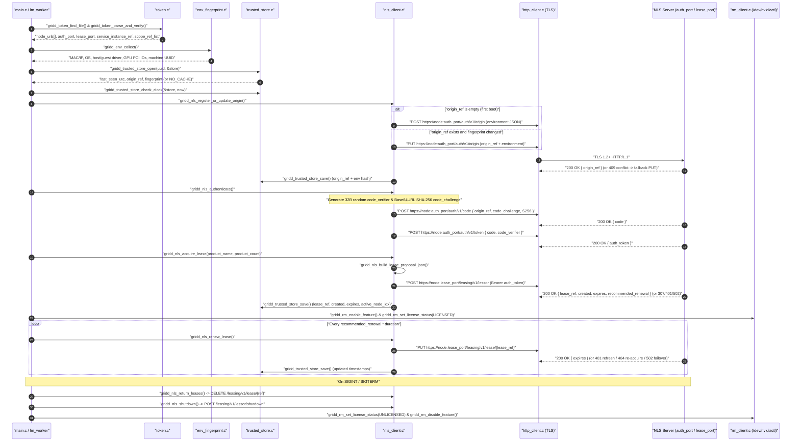
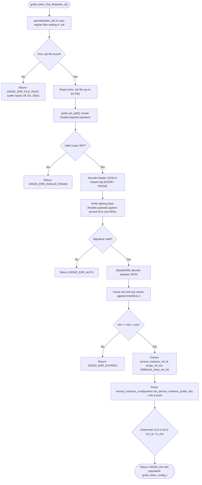
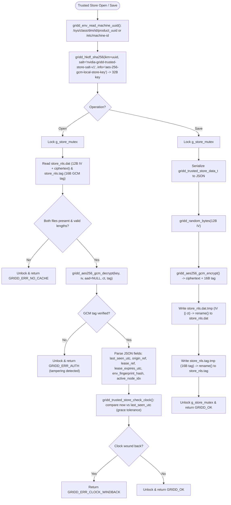
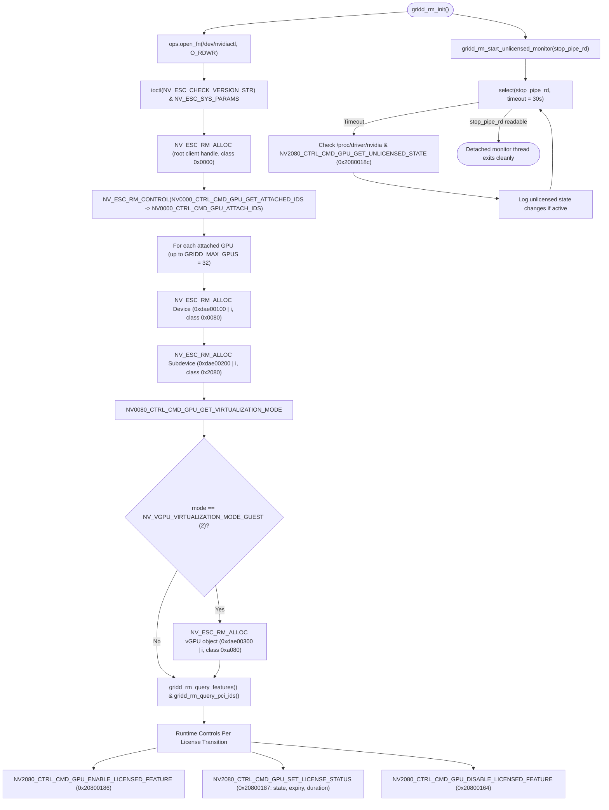
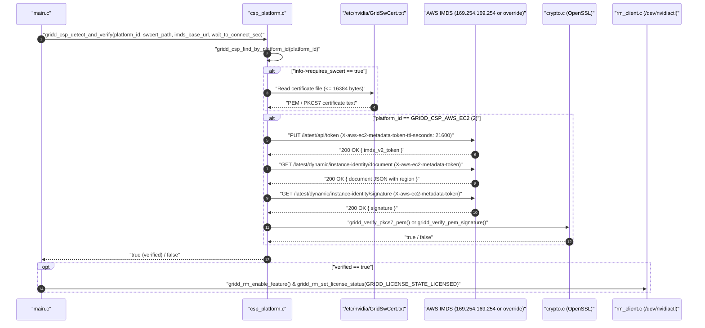
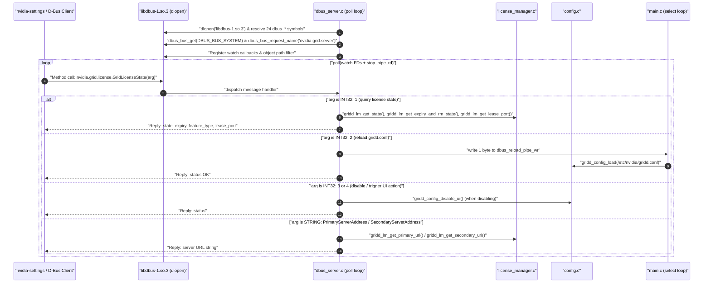
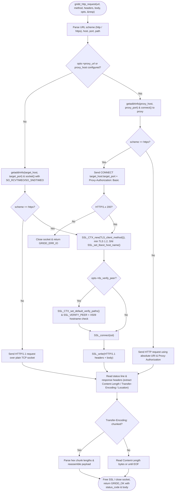

# `nvidia-gridd` Subsystem Flowcharts

This document contains detailed sequence diagrams and operational flowcharts for each major subsystem in the clean-room `nvidia-gridd` codebase.

## 1. End-to-End NLS Licensing Protocol Sequence

Covers JWT parsing, PKCE S256 generation, `/auth/v1/origin`, `/auth/v1/code`, `/auth/v1/token`, `/leasing/v1/lessor`, `/leasing/v1/lease/{ref}`, encrypted store updates, and clean shutdown via `DELETE` + `/leasing/v1/lessor/shutdown`.

## 2. Client Configuration Token (`.tok`) Discovery & JWT Verification

Executed by `gridd_token_find_file()` and `gridd_token_parse_and_verify()` in [`src/token.c`](../src/token.c):

## 3. Encrypted Trusted Store & Anti-Tamper Check Flow

Implemented in [`src/trusted_store.c`](../src/trusted_store.c) using AES-256-GCM and HKDF-SHA256:

## 4. NVIDIA RM Device Ioctls & 30-Second Unlicensed Monitor

Implemented in [`src/rm_client.c`](../src/rm_client.c) using `/dev/nvidiactl` and mockable `gridd_rm_ops_t` vtable hooks:

## 5. CSP Marketplace Detection & AWS IMDSv2 Verification

Executed by `gridd_csp_detect_and_verify()` in [`src/csp_platform.c`](../src/csp_platform.c) when `marketplace_platform != 0`:

## 6. D-Bus IPC & Configuration Reload Flow

Implemented in [`src/dbus_server.c`](../src/dbus_server.c) via `dlopen("libdbus-1.so.3")` so the daemon links cleanly even on minimal Linux images without D-Bus dev headers:

## 7. Native HTTP/1.1, OpenSSL TLS 1.2+ & Proxy `CONNECT` Tunnel

Implemented without `libcurl` in [`src/http_client.c`](../src/http_client.c):

