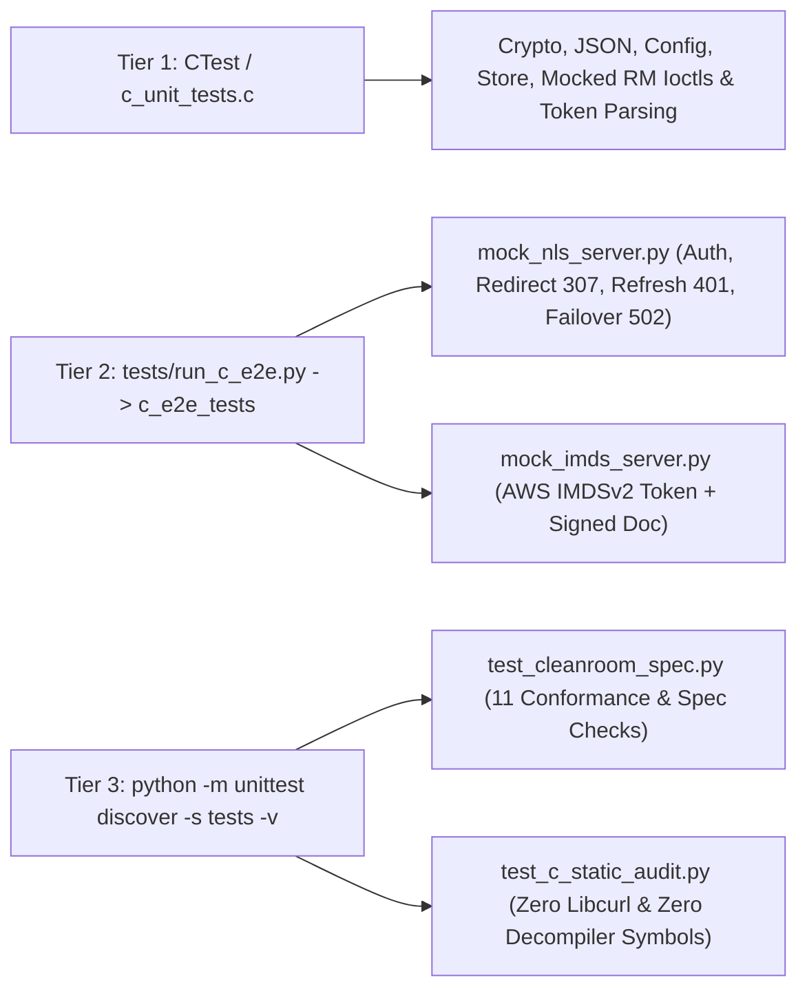

# Build, Operations & Testing Guide

Operational deployment, configuration, CMake compilation, and verification reference for the clean-room C11 `nvidia-gridd` daemon.

---

## 1. Building from Source (Linux)

### Dependencies
| Dependency | Purpose | Minimum / Notes |
| --- | --- | --- |
| **CMake** | Build configuration (`CMakeLists.txt`) | CMake >= 3.16 |
| **C11 Compiler** | GCC or Clang with strict C11 flags | `-std=c11 -Wall -Wextra -Werror -Wpedantic` (verified on GCC 15.2.0 & Clang 21.1.8) |
| **OpenSSL 3.x (`libssl-dev`)** | SHA-256, HKDF, AES-256-GCM, ECDSA/RSA, PKCS#7, TLS 1.2+ | Replaces `libcurl`; no `libcurl` dependency required |
| **POSIX Threads (`Threads::Threads`)** | LM worker, D-Bus server, RM monitor threads | Standard glibc `libpthread` |
| **Dynamic Loader (`dl`)** | Runtime loading of `libdbus-1.so.3` | No D-Bus build headers required at compile time |
| **Python 3 + `cryptography`** | Running conformance tests and mock NLS/IMDS harnesses | Python 3.8+ with `cryptography` (optional for runtime daemon) |

### Build & Install Commands
```bash
# Release build (GCC default)
cmake -B build -DCMAKE_BUILD_TYPE=Release
cmake --build build -j

# Optional Clang build with Ninja
CC=clang cmake -B build-clang -G Ninja -DCMAKE_BUILD_TYPE=Release
cmake --build build-clang -j

# System installation (installs nvidia-gridd -> sbin, systemd unit, gridd.conf.template)
sudo cmake --install build --prefix /usr
```

### CMake Targets ([`CMakeLists.txt`](../CMakeLists.txt))
| Target | Kind | Sources | Output / Purpose |
| --- | --- | --- | --- |
| `gridd_core` | Static library | 14 files in `src/` (excluding `src/main.c`) | Reusable core library shared by daemon & test binaries. |
| `nvidia-gridd` | Executable | `src/main.c` + `gridd_core` | Production licensing daemon installed to `sbin/`. |
| `c_unit_tests` | Executable | `tests/c_unit_tests.c` + `gridd_core` | Registered in CTest (`gridd_c_unit_tests`). |
| `c_e2e_tests` | Executable | `tests/c_e2e_tests.c` + `gridd_core` | Live C client harness invoked by `tests/run_c_e2e.py`. |

---

## 2. Deployment, Configuration & CLI

### CLI Arguments ([`src/main.c`](../src/main.c))
| Flag | Effect |
| --- | --- |
| *(none)* | Background daemon mode (`fork()`, `setsid()`, PID lock in `/var/run/nvidia-gridd/nvidia-gridd.pid`, logs to `syslog` `LOG_DAEMON`). |
| `-f` | Foreground mode (no `fork()`, logs directly to `stderr`, ignores PID file creation). |
| `-v` | Verbose logging (`GRIDD_LOG_DEBUG` messages included). |

### Configuration (`/etc/nvidia/gridd.conf`)
Template provided at [`packaging/gridd.conf.template`](../packaging/gridd.conf.template):

| Key | Default | Description |
| --- | --- | --- |
| `FeatureType` | `0` (`2` in template) | `0` Unlicensed, `1` vGPU, `2` vWS (Quadro vDWS), `3` vGaming, `4` vCS. |
| `EnableUI` | `TRUE` | Enables D-Bus `nvidia.grid.server` IPC thread; auto-disabled atomically for CLS tokens. |
| `ClientConfigTokenPath` | `/etc/nvidia/ClientConfigToken` | Directory or `.tok` file path for NLS client configuration tokens. |
| `LicenseFilePath` | *(empty)* | Optional path to Node-Locked License (`.lic`) file. |
| `IgnoreSP` | `FALSE` | Bypass service provider marketplace checks when set `TRUE`. |
| `IgnoreNodeLocked` | `FALSE` | Skip offline `.lic` NLL evaluation and proceed directly to NLS token mode. |
| `LicenseInterval` | `0` | Custom lease request duration override in minutes. |
| `MarketplacePlatform` | `0` | CSP ID (`1` Azure, `2` AWS EC2, `3` GCP, `4` Alibaba ECS, `5` Tencent, `6` Tencent IEG). |
| `WaitToConnectIMDS` | `120` | AWS IMDS connection timeout window in seconds (clamped `20..1200`). |
| `ProxyServerAddress` / `ProxyServerPort` | *(empty)* | HTTP/HTTPS `CONNECT` proxy host and port. |
| `ProxyUserName` / `ProxyCredentialsFilePath` | *(empty)* | Proxy Basic authentication credentials (`username` + password file). |
| `PlatformIdentification` | *(empty)* | Optional platform identification string. |

### Systemd Service ([`packaging/nvidia-gridd.service`](../packaging/nvidia-gridd.service))
- Installed to `/usr/lib/systemd/system/nvidia-gridd.service`.
- Configured as `Type=forking` with `PIDFile=/var/run/nvidia-gridd/nvidia-gridd.pid`, `ExecStart=/usr/sbin/nvidia-gridd`, `Restart=on-failure`, and `RestartSec=5`.

```bash
sudo cp /usr/share/nvidia/gridd.conf.template /etc/nvidia/gridd.conf
sudo systemctl enable --now nvidia-gridd
sudo journalctl -u nvidia-gridd -f
```

### Runtime Filesystem Paths
| Path | Purpose |
| --- | --- |
| `/dev/nvidiactl` | NVIDIA Resource Manager character device for RM allocation/control ioctls. |
| `/var/run/nvidia-gridd/nvidia-gridd.pid` | `lockf(F_TLOCK)`-protected singleton daemon PID file. |
| `/etc/nvidia/ClientConfigToken/*.tok` | Signed NLS client configuration JWT token(s). |
| `/var/lib/nvidia/vGPULicensing/store_nls.dat` & `store_nls.tag` | AES-256-GCM encrypted origin/lease/clock store and 16-byte authentication tag. |
| `/etc/nvidia/GridSwCert.txt` | Cloud Service Provider software entitlement certificate (max 16 KiB). |
| `/var/lib/nvidia/GridLicensing`, `/etc/nvidia/license`, `/etc/nvidia/vGPULicense` | State directories ensured at daemon startup. |

### Troubleshooting Quick Reference
| Symptom / Error | Likely Cause | Action |
| --- | --- | --- |
| `GRIDD_ERR_FILE_READ` waiting on `.tok` | No `.tok` token in `/etc/nvidia/ClientConfigToken` | Place valid `.tok` from NVIDIA Licensing Portal; daemon polls every 10s..300s automatically. |
| `GRIDD_ERR_AUTH` on trusted store open | Corrupt `store_nls.dat`/`store_nls.tag` or changed machine DMI UUID | Verify `/sys/class/dmi/id/product_uuid` or `/etc/machine-id` stability; clear stale store files only when re-registering host. |
| `GRIDD_ERR_CLOCK_WINDBACK` | System time jumped backwards relative to `system_clock_snapshot` | Synchronize host clock via NTP/chrony. |
| `GRIDD_ERR_RM` at startup | NVIDIA kernel driver unloaded or insufficient privileges on `/dev/nvidiactl` | Ensure `nvidia.ko` is loaded and daemon runs as `root` (or with `/dev/nvidiactl` rw permission). |
| `dlopen(libdbus-1.so.3)` notice | D-Bus shared library absent on headless container | Expected fallback; licensing continues normally without D-Bus UI IPC. |

---

## 3. Three-Tier Verification & Testing Architecture

The codebase uses three complementary test tiers ensuring unit correctness, live network protocol compliance, and clean-room integrity:



### Test Suite Inventory
| File | Language | Scope & Responsibility |
| --- | --- | --- |
| [`tests/c_unit_tests.c`](../tests/c_unit_tests.c) | C11 | Tests Base64/Base64URL, SHA-256, PKCE, HKDF, AES-256-GCM encryption/tamper rejection, JSON builder/parser, `gridd.conf` load & UI disable, clock windback, NLL evaluation, `.tok` validation, and mocked `gridd_rm_ops_t` ioctl sequences. |
| [`tests/c_e2e_tests.c`](../tests/c_e2e_tests.c) | C11 | Executes live compiled HTTP/TLS/PKCE client flows against local mock servers (`gridd_nls_*`, `gridd_lm_*`, `gridd_csp_detect_and_verify`). |
| [`tests/mock_nls_server.py`](../tests/mock_nls_server.py) | Python 3 | Stateful mock NLS node implementing `/auth/v1/origin` (200/409), `/auth/v1/code`, `/auth/v1/token`, `/leasing/v1/lessor` (200/307/401/502), `/leasing/v1/lease/{ref}`, `/leasing/v1/lessor/leases`, and `/leasing/v1/lessor/shutdown`. |
| [`tests/mock_imds_server.py`](../tests/mock_imds_server.py) | Python 3 | Mock AWS EC2 IMDSv2 server serving `PUT /latest/api/token` and signed instance identity documents. |
| [`tests/run_c_e2e.py`](../tests/run_c_e2e.py) | Python 3 | Orchestrates ephemeral mock NLS + IMDSv2 servers, generates signed test `.tok` JWTs, invokes `build/c_e2e_tests`, and asserts live request counts and lease lifecycle cleanup. |
| [`tests/test_cleanroom_spec.py`](../tests/test_cleanroom_spec.py) | Python 3 | Validates clean-room behavior specifications (PKCE, JWT, store format, error codes, RM feature mapping) via Python `unittest`. |
| [`tests/test_c_static_audit.py`](../tests/test_c_static_audit.py) | Python 3 | Audits `include/`, `src/`, `tests/`, `packaging/`, `CMakeLists.txt`, and `docs/` to verify zero decompiler symbol leakage and zero `libcurl` references in clean-room code. |

### Running All Tests
```bash
# 1. C unit tests via CTest (Linux)
ctest --test-dir build --output-on-failure

# 2. Live C-to-Mock-Server E2E integration tests (Linux)
python3 tests/run_c_e2e.py build/c_e2e_tests

# 3. Python conformance + static clean-room audit suite (Windows or Linux)
python3 -B -m unittest discover -s tests -v
```

---

## 4. Packaging & Release Artifacts (`CPack` & `build-package.sh`)

[`CMakeLists.txt`](../CMakeLists.txt) configures CPack (`DEB`, `TGZ`, and optional `RPM`) with `GRIDD_PACKAGE_VERSION` (default `1.0.0`), automatic ELF shared-library dependency resolution (`CPACK_DEBIAN_PACKAGE_SHLIBDEPS ON`), stripped binaries (`CPACK_STRIP_FILES TRUE`), and LF-normalized Debian maintainer scripts.

### Local Linux Packaging ([`packaging/build-package.sh`](../packaging/build-package.sh))
| Flag | Default | Description |
| --- | --- | --- |
| `--compiler gcc\|clang` | `gcc` | Selects the C compiler (`CC`). |
| `--build-type Release\|Debug` | `Release` | Sets `CMAKE_BUILD_TYPE`. |
| `--format deb\|tgz\|rpm\|all` | `all` | Selects generated package formats (`all` builds `DEB` when `dpkg-deb` exists, `TGZ`, and `RPM` when `rpmbuild` exists). |
| `--version X.Y.Z` | `1.0.0` | Sets `GRIDD_PACKAGE_VERSION` for CPack outputs. |
| `--build-dir DIR` | `<repo>/build-pkg` | CMake build directory. |
| `--out-dir DIR` | `<repo>/dist` | Destination directory for packages and `SHA256SUMS`. |
| `--skip-tests` | *(off)* | Skips CTest, live E2E, and Python unittest verification gates. |
| `--clean` | *(off)* | Deletes `--build-dir` before configuring. |

```bash
chmod +x packaging/build-package.sh packaging/debian/postinst packaging/debian/prerm
./packaging/build-package.sh --clean
```

### Debian Maintainer Hooks & Outputs
- [`packaging/debian/postinst`](../packaging/debian/postinst): Creates `/etc/nvidia/{ClientConfigToken,license,vGPULicense}` and `/var/lib/nvidia/{vGPULicensing,GridLicensing}`, initializes `/etc/nvidia/gridd.conf` from `/usr/share/nvidia/gridd.conf.template` if absent, and reloads `systemd` when running.
- [`packaging/debian/prerm`](../packaging/debian/prerm): Stops `nvidia-gridd.service` cleanly on package removal (`remove`, `deconfigure`, or RPM `0`).
- **Artifacts in `dist/`:** `nvidia-gridd_<version>_<arch>.deb`, `nvidia-gridd-<version>-Linux.tar.gz` (plus `.rpm` on RPM hosts), and `SHA256SUMS`. After packaging `.deb` files, `build-package.sh` inspects metadata (`dpkg-deb -I`) and file layout (`dpkg-deb -c`).

### Windows-to-Linux Remote Packaging & Antigravity Skill
- Workspace skill: [`.agents/skills/build-and-package-gridd/SKILL.md`](../.agents/skills/build-and-package-gridd/SKILL.md)
- PowerShell helper: [`.agents/skills/build-and-package-gridd/scripts/remote-package.ps1`](../.agents/skills/build-and-package-gridd/scripts/remote-package.ps1)

```powershell
# Sync clean-room sources, strip CRLF on scripts, build/test on 192.168.1.15, and download dist/
powershell -ExecutionPolicy Bypass -File ".agents\skills\build-and-package-gridd\scripts\remote-package.ps1" -Clean
```

